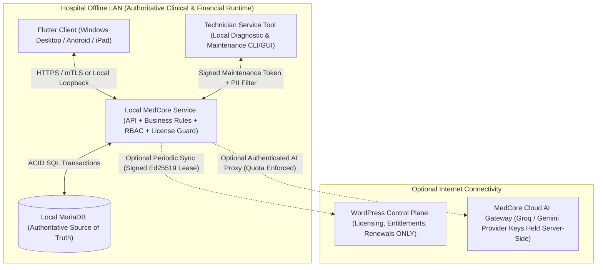

# MEDCORE — CORE EXTRACTION SPECIFICATION (A–J TAXONOMY CLASSIFICATION)
**Document ID**: `DOC-02` | **Source**: `Project 3` Static Reconnaissance

---

## 1. Purpose & Architectural Boundary
This specification classifies every subsystem, service, store, table, and route in `Project 3` into the mandatory **A–J Taxonomy** so that `MedCore Desktop` (`Flutter Client → Local MedCore Service → Local MariaDB`) preserves 100% of authoritative hospital logic while discarding Web/WordPress runtime coupling.

---

## 2. Comprehensive A–J Classification Matrix

### 2.1 Backend Domain Services & Controllers (`Backend/MedCorePlugin`)
| Source File (`Project 3`) | Lines | Primary Responsibility | Taxonomy Category | Disposition for `MedCore Desktop` |
|---|---|---|---|---|
| `includes/core/class-medcore-financial-transaction-service.php` | 1,656 | Monetary equation validation, `mc_financial_events` & `mc_financial_postings` ledger, visit reversal & adjustment | **A / D** (Core Financial Logic) | **EXTRACT LOGIC** into Local MedCore Service; fix settlement double-debit (`FIN-BUG-01`), fix currency drift (`FIN-BUG-02`), add Service vs Consumable split (`FIN-GAP-01`). |
| `includes/core/class-medcore-commission-engine.php` | 413 | 2-tier commission calculation (`mc_definition_rules` + doctor JSON fallback, specificity scoring, cap/floor) | **A / D** (Core Financial Logic) | **EXTRACT LOGIC** into Local MedCore Service; compute commission on `CommissionableNet = ServiceNet - DeductibleConsumableCost`. |
| `includes/core/class-medcore-shift-service.php` | 551 | Cashier shift open, active shift enforcement, expected cash calculation, blind/reconciled close, handover | **A / D** (Core Financial Logic) | **EXTRACT LOGIC** into Local MedCore Service. |
| `includes/core/class-medcore-visit-service.php` | 1,753 | 12-step atomic visit creation, appointment promotion, diagnostic order creation, visit cancel/refund/adjust | **A / E** (Core Clinical + Financial) | **EXTRACT LOGIC** into Local MedCore Service; wire automatic FIFO consumable deduction (`MedCore_Inventory_Consumption`) into visit/procedure execution. |
| `includes/core/class-medcore-inventory-cost-engine.php` | 23 | Batch unit cost calculation | **A / D** (Core Financial Logic) | **EXTRACT LOGIC** into Local MedCore Service. |
| `includes/core/class-medcore-inventory-consumption.php` | 52 | FIFO batch stock deduction (`mc_inventory_StockBatch`) + movement logging (`mc_inventory_StockMovement`) | **A / E / D** | **EXTRACT & CONNECT**: Currently dead/unwired in `create_visit`; must be wired to service BOM (`mc_service_consumables_bom`) in Desktop. |
| `includes/core/class-medcore-admissions-service.php` | 185 | Inpatient admission creation, bed locking (`FOR UPDATE`), bed transfer, discharge | **A / E** (Core Clinical Logic) | **EXTRACT LOGIC** into Local MedCore Service. |
| `includes/core/class-medcore-surgery-service.php` | 167 | Surgery booking, OR theater status transitions, checklist & anesthesia records, surgery consumables | **A / E** (Core Clinical Logic) | **EXTRACT LOGIC** into Local MedCore Service. |
| `includes/core/class-medcore-dialysis-service.php` | 236 | Dialysis machine assignment, session state machine (`SCHEDULED -> CHECKED_IN -> IN_PROGRESS -> COMPLETED`) | **A / E** (Core Clinical Logic) | **EXTRACT LOGIC** into Local MedCore Service. |
| `includes/core/class-medcore-icu-nicu-clinical-service.php` | 214 | ICU/NICU flowcharts, ventilator/incubator parameters, clinical severity scores | **A / E** (Core Clinical Logic) | **EXTRACT LOGIC** into Local MedCore Service. |
| `includes/security/class-medcore-security.php` | 730 | Role definitions (10 roles), permission mapping (43 backend perms <-> UI perms), tenant verification | **C** (Security / Authorization) + **G** (WP transients) | **REDESIGN SESSION & RBAC**: Keep the 10-role + resource permission taxonomy (`Category C`), discard WP transient token lookup (`Category G`), bind tokens to `(staff_id, hospital_code, device_id)`. |
| `includes/domain/staff/class-auth-service.php` | 391 | Staff password verification, login token issuance, profile hydration | **C** + **G** | **EXTRACT AUTH RULES (`C`)**, replace WP `wp_check_password`/transients (`G`) with Argon2id/Bcrypt + local `mc_auth_sessions` table. |
| `includes/api/class-api-financial-settlement.php` | 457 | Doctor/beneficiary commission settlement preview, batch creation, approval, payout execution | **D** (Financial Logic) | **EXTRACT & FIX**: Fix double-debit bug on `SETTLE-TR-*` (`CREDIT` `TREASURY_CASH`, `DEBIT` `PAYABLE_COMMISSION`). |
| `includes/api/class-api-desktop.php` | 112 | `/desktop-version`, `/tutorials`, `/verify-device` | **G / I** (Stub in P3) | **REPLACE COMPLETELY**: Current file is a non-functional stub (`verify-device` always returns `true`). Implement real cryptographic device binding in Local MedCore Service (`Category I`). |
| `includes/api/class-api-sync.php` | 273 | `/medcore/v1/sync/push` & `/pull` (only supports `patient:create`) | **F / G / H** | **SUPERSEDED BY LAN ARCHITECTURE**: In `MedCore Desktop`, Flutter clients talk directly to Local MedCore Service over Hospital LAN (`Category H`), eliminating browser-to-cloud offline queues for local operations. |
| `includes/api/class-api-saas.php` & `class-api-saas-extended.php` | 719 | SaaS plans, checkout stubs, `/mce/v1/license` | **G / I** (Control Plane) | **KEEP ON WORDPRESS CONTROL PLANE ONLY**: Harden `/mce/v1/license` to issue **Ed25519-signed license leases** (`Category I`) consumed by Local MedCore Service. |
| `includes/api/class-api-ai.php` & `class-api-ai-extra.php` | 329 | `/medcore-ai/v1/keys`, AI usage logs, token deduction | **G / I** (AI Cell) | **REMOVE `/medcore-ai/v1/keys` IMMEDIATELY**: Never expose raw Groq/Gemini keys (`SEC-FLAW-04`). Route all AI calls through authenticated Cloud AI Gateway (`Category I`). |
| `Backend/medcore-database-explorer/api/class-dbx-api-router.php` | 2,434 | 70-domain Database Mirror, relational links, sensitive field masking | **B / C / I** | **EXTRACT DOMAIN METADATA (`B`)** for Technician Service Tool & SuperAdmin DB Inspector (`Category I`). |

---

### 2.2 Frontend Modules, Stores & Infrastructure (`Frontend/src`)
| Frontend Sub-System (`Project 3`) | File Count | Taxonomy Category | Disposition for `MedCore Desktop` |
|---|---|---|---|
| `src/lib/navigationConfig.ts` & `src/components/Sidebar.tsx` | 2 | **A / C / UI DESIGN REFERENCE** | **PRESERVE CANONICAL IA**: All 19 top-level sections and 63 subpages (82 nodes) + permission & license module mappings define the Flutter navigation tree. |
| `src/lib/permissions.ts` & `src/hooks/usePermissions.ts` | 2 | **C** (Security / Authorization) | **UNIFY & PORT**: Preserve all 261 permission keys (`87` base, `87` `_all`, `87` `_secure`) and 4 operational flags (`canDelete`, `canEdit`, `canCollectMoney`, `canMakeRefunds` + `refundPolicy`), while restoring the 4 missing roles (`Pharmacist`, `Lab`, `Radiology`, `Cashier`). |
| `src/components/PermissionGuard.tsx` | 1 | **F** (React Wrapper) + **C** (Flawed Guard) | **DO NOT PORT BUG (`SEC-FLAW-01`)**: In Flutter + Local MedCore Service, `permissionsMode = "default"` MUST evaluate the role's default permission set (`DEFAULT_ROLE_PERMISSIONS[role]`), NEVER a wildcard bypass! |
| `src/store/*.ts` (48 Zustand Stores) | 48 | **F** (Zustand/`localStorage`) + **A/B** (Client State Shapes) | **DO NOT PORT `localStorage` PERSISTENCE**: Extract entity DTOs and validation rules (`A/B`); in Flutter, state is fetched from and mutated against Local MedCore Service (`Local MariaDB`). |
| `src/lib/offlineSync.ts` & `src/lib/tenantStorage.ts` | 2 | **F / H** | **DISCARD**: Browser `localStorage` queue supporting only `patient:create` is replaced by direct LAN transactions against Local MedCore Service. |
| `src/app/api/**/route.ts` (14 Next.js API Routes) | 14 | **F** (Web Proxy) + **I** (AI Prompt Templates) | **EXTRACT AI PROMPTS (`ai-doctor/route.ts`)** into Cloud AI Gateway; discard Next.js server routes (`Category F`). |
| `src/messages/ar.json` & `en.json` + Tailwind UI Tokens | 6 | **UI DESIGN REFERENCE** | **EXTRACT TRANSLATIONS & DESIGN TOKENS** for Flutter localization (`arb`/JSON) and `ThemeData`. |
