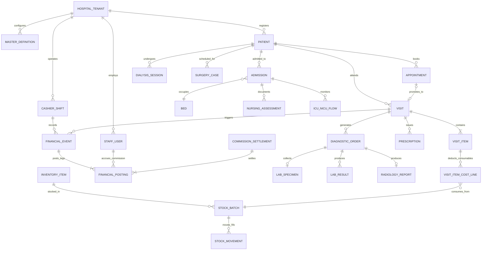

# MEDCORE — CANONICAL DOMAIN MODEL (`CATEGORY B`)
**Document ID**: `DOC-03` | **Source**: Extracted from 79 SQL Tables, 70 DBX Domains, and 48 Frontend Stores

---

## 1. Bounded Contexts & Domain Aggregates
The MedCore hospital domain comprises **12 Bounded Contexts**:
1. **Tenant, Organization & Master Definitions (`Tenant & Catalog Context`)**
2. **Identity, Staff, HR & RBAC (`Identity & HR Context`)**
3. **Patient Master Index (`MPI & CRM Context`)**
4. **Scheduling, Appointments & Queue (`Scheduling Context`)**
5. **Outpatient Visits & Clinical EMR (`Outpatient Clinical Context`)**
6. **Diagnostic Orders: Laboratory & Blood Bank (`Laboratory Context`)**
7. **Diagnostic Orders: Radiology & PACS Metadata (`Radiology Context`)**
8. **Pharmacy, Dispensing & Multi-Warehouse Inventory (`Pharmacy & Inventory Context`)**
9. **Inpatient Admissions, Wards, Beds & Nursing (`Inpatient & Nursing Context`)**
10. **Specialized Critical Care: ICU, NICU, Surgery/OR & Dialysis (`Specialized Care Context`)**
11. **Financial Sub-Ledger, Shifts, Treasury, Insurance AR & Commissions (`Financial & Accounting Context`)**
12. **System Governance: Licensing, Devices, Clock Guard, Audit & Backups (`Platform Governance Context`)**

---

## 2. Core Entity Relationship Diagram (Canonical Domain Model)

---

## 3. Canonical Entity Lifecycle & State Machines

### 3.1 Appointment Lifecycle (`wp_mc_appointments`)
- **States**: `SCHEDULED` → `CONFIRMED` → `ARRIVED` / `CHECKED_IN` → `IN_PROGRESS` → `COMPLETED` | `CANCELLED` | `NO_SHOW`.
- **Invariants**:
  - Promoting an appointment to a visit (`MedCore_Visit_Service::create_visit`, `class-medcore-visit-service.php:235-268`) acquires a row lock (`SELECT ... FOR UPDATE`), verifies `status != 'CANCELLED'` and `visit_id IS NULL`, links `visit_id`, and transitions status to `COMPLETED`/`CHECKED_IN`.

### 3.2 Visit Lifecycle (`wp_mc_visits`)
- **Administrative States (`status`)**: `ACTIVE` → `COMPLETED` | `CANCELLED` | `REFUNDED` | `PARTIALLY_REFUNDED`.
- **Clinical Queue States (`clinical_status`)**: `WAITING` → `TRIAGED` → `IN_CONSULTATION` → `AWAITING_DIAGNOSTICS` → `COMPLETED`.
- **Invariants**:
  - A visit with executed downstream clinical actions (verified lab result, finalized radiology report, dispensed medication) CANNOT be administratively cancelled without clinical reversal or authorized partial adjustment (`MedCore_Visit_Service::cancel_visit`).

### 3.3 Financial Event & Sub-Ledger Lifecycle (`wp_mc_financial_events` & `wp_mc_financial_postings`)
- **Event Types (`event_type`)**: `VISIT_CREATE`, `VISIT_REVERSAL`, `VISIT_ADJUSTMENT`, `PATIENT_PAYMENT_COLLECTION`, `PATIENT_REFUND`, `COMMISSION_SETTLEMENT`, `TREASURY_VOUCHER_IN`, `TREASURY_VOUCHER_OUT`, `INSURANCE_CLAIM_SETTLEMENT`.
- **Event Status (`status`)**: `POSTED` → `REVERSED` (immutable append-only ledger; rows are never updated or deleted to change historical numbers; reversals insert a new compensating `event_id` with `reversal_of_event_id` pointing to the original event).

### 3.4 Cashier Shift Lifecycle (`wp_mc_shifts`)
- **States (`status`)**: `OPEN` → `CLOSING_REVIEW` → `CLOSED` → `HANDED_OVER` / `RECONCILED`.
- **Invariants**:
  - A cashier user can have at most **1 `OPEN` shift** per `hospital_code` at any time (`MedCore_Shift_Service::open_shift`, `class-medcore-shift-service.php:35-95`).
  - Any financial transaction with `$paid > 0` or `$refund > 0` requires an active `OPEN` shift (`require_open_shift`).
  - Closing a shift computes `expected_cash = opening_balance + cash_in - cash_out`, compares against `counted_cash`, and records `variance_amount = counted_cash - expected_cash`.

### 3.5 Laboratory Order & Specimen Lifecycle (`wp_mc_orders`, `wp_mc_lab_specimens`, `wp_mc_lab_results`)
- **States**: `ORDERED` → `SAMPLE_COLLECTED` → `RECEIVED_IN_LAB` → `PROCESSING` → `RESULT_ENTERED` → `VERIFIED` → `DELIVERED` (or `REJECTED_SAMPLE` → `RECOLLECTION_REQUIRED`).

### 3.6 Radiology Order Lifecycle (`wp_mc_orders`, `wp_mc_radiology_reports`)
- **States**: `ORDERED` → `SCHEDULED` → `PATIENT_ARRIVED` → `EXAM_COMPLETED` → `REPORT_DRAFTED` → `REPORT_FINALIZED`.

### 3.7 Inpatient Admission & Bed Lifecycle (`wp_mc_admissions`, `wp_mc_beds`)
- **Bed States**: `AVAILABLE` → `RESERVED` → `OCCUPIED` → `CLEANING` / `MAINTENANCE` → `AVAILABLE`.
- **Admission States**: `ADMITTED` → `TRANSFERRED` → `DISCHARGE_ORDERED` → `FINANCIALLY_CLEARED` → `DISCHARGED`.

### 3.8 Dialysis Session Lifecycle (`wp_mc_dialysis_sessions`)
- **States**: `SCHEDULED` → `CHECKED_IN` → `IN_PROGRESS` (machine bound, pre-vitals recorded) → `COMPLETED` (post-vitals, UF volume, machine released to sterilization) | `ABORTED`.

### 3.9 Surgery Case Lifecycle (`wp_mc_surgeries`)
- **States**: `BOOKED` → `PRE_OP_CHECKLIST` → `ANESTHESIA_INDUCTION` → `IN_SURGERY` → `PACU_RECOVERY` → `COMPLETED` | `CANCELLED`.
