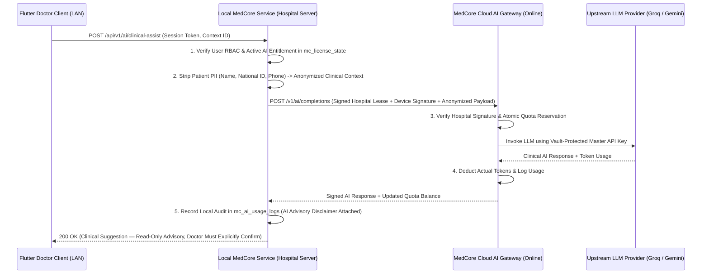

# MEDCORE — AI CELL CURRENT STATE & TARGET SECURE GATEWAY BLUEPRINT (`CATEGORY I`)
**Document ID**: `DOC-13` | **Source**: `Frontend/src/app/api/ai-doctor/route.ts` (341 lines), `Frontend/src/app/api/admin-ai/route.ts` (97 lines), `Backend/MedCorePlugin/includes/api/class-api-ai.php` (163 lines), `class-api-ai-extra.php` (166 lines)

---

## 1. Current AI Implementation in `Project 3` (`FACT`)

### 1.1 Existing AI Capabilities
1. **AI Clinical Co-Pilot (`Frontend/src/app/api/ai-doctor/route.ts` & `Frontend/src/components/AIDoctorDrawer.tsx`)**:
   - Supports clinical differential diagnosis suggestions, lab result interpretation, prescription drug-interaction checks, ICD-10 coding assistance, and SOAP note summarization.
   - Uses a multi-provider fallback chain:
     - Primary: **Groq** (`openai/gpt-oss-120b`, `llama-3.3-70b-versatile`, `llama-3.1-8b-instant`).
     - Fallback: **Google Gemini** (`gemini-3.8-flash`, `gemini-3.6-flash`, `gemini-2.0-flash`, `gemini-1.5-flash`).
2. **AI Hospital Executive Assistant (`Frontend/src/app/api/admin-ai/route.ts`)**:
   - Answers natural-language operational/financial queries using hospital summary metrics.
3. **AI Token Ledger (`wp_mc_ai_usage_logs`, `class-api-ai.php`, `class-api-ai-extra.php`)**:
   - Tracks `tokens_used`, `feature_name`, `user_id`, and `hospital_code`, and deducts from the tenant's AI token balance (`POST /wp-json/mce/v1/ai/usage/consume` and `/medcore/v1/ai-deduct`).

### 1.2 Critical Security Vulnerabilities in `Project 3` AI (`FACT`)
- **`SEC-FLAW-04` (P0 CRITICAL)**: `GET /wp-json/medcore-ai/v1/keys` (`class-api-ai.php:6-18`) has `permission_callback => '__return_true'` and returns the master `groq_api_key` and `gemini_api_key` in plaintext JSON whenever the static header `X-MedCore-Server-Action: fetch-ai-keys` is sent!
- **Unauthenticated Next.js AI Routes**: `Frontend/src/app/api/ai-doctor/route.ts` and `admin-ai/route.ts` do not verify the caller's MedCore session token or check AI token balance before invoking Groq/Gemini; token deduction is triggered separately by the client after receiving the response.

---

## 2. Target Secure AI Cell Architecture for `MedCore Desktop`

### 2.1 Zero-Key-In-Client & Zero-Key-On-Hospital-Server Principle
- **Master Groq/Gemini/OpenAI API keys MUST NEVER exist in the Flutter binary, on the client device, or inside the on-premise Hospital Server database**.
- **Delete `GET /wp-json/medcore-ai/v1/keys` permanently**.

### 2.2 Offline Behavior & Clinical Safety Guardrails
1. **Graceful Offline Disablement**: The AI Cell is strictly an **optional online capability**. When the Hospital Server has no internet connection, `Local MedCore Service` returns `ai_status: "OFFLINE_UNAVAILABLE"` and the Flutter UI disables the AI Co-Pilot drawer cleanly without affecting any clinical or financial workflow.
2. **PII De-Identification Before Cloud Transmission**: `Local MedCore Service` strips patient name, MRN, phone number, and national ID before sending clinical vitals/labs/symptoms to the Cloud AI Gateway (sending only `age`, `biological_sex`, `vitals`, `lab_parameters`, `symptoms`).
3. **Human-in-the-Loop Mandate**: AI outputs are strictly **advisory (`DECISION_SUPPORT_ONLY`)**. The AI Cell can never autonomously write to `mc_prescriptions`, `mc_orders`, or `mc_financial_events`; a licensed `Doctor` must review and explicitly click `"Apply to Draft"` + `"Sign Order"`.
