# MEDCORE — DESKTOP FOUNDATION IMPLEMENTATION ROADMAP (`PHASES 0–12`)
**Document ID**: `DOC-19` | **Target Product**: `MedCore Desktop` (Flutter + Local MedCore Service + Local MariaDB + Optional Control Plane & AI Gateway)

---

## 1. Phased Execution Architecture (Dependency-Ordered)

```mermaid
flowchart LR
    P0["Phase 0: Architectural Sign-Off & Decisions (UNK-01..05)"] --> P1["Phase 1: Local MariaDB Schema & Migration Engine (85 Tables)"]
    P1 --> P2["Phase 2: Local MedCore Service Core, Auth, 10-Role RBAC & Security"]
    P2 --> P3["Phase 3: License Engine, Device Binding & 4-Source Clock Guard"]
    P3 --> P4["Phase 4: Financial Sub-Ledger, Shifts & Service-vs-Consumable Commission Engine"]
    P4 --> P5["Phase 5: Flutter Desktop Shell, Design System & Native Screen Protection"]
    P5 --> P6["Phase 6: MPI, Reception, Appointments & Atomic 12-Step Visit Pipeline"]
    P6 --> P7["Phase 7: Outpatient Clinics, Doctor Portal & e-Rx"]
    P7 --> P8["Phase 8: LIS (Lab/Blood Bank), RIS (Radiology) & Pharmacy/FIFO Inventory"]
    P8 --> P9["Phase 9: Inpatient Wards, Bed Map, Nursing, ICU/NICU, Surgery & Dialysis"]
    P9 --> P10["Phase 10: Technician Service Tool (Executive Report + Engineering Bundle + PII Filter)"]
    P10 --> P11["Phase 11: Optional Cloud AI Gateway & WordPress Control Plane Integration"]
    P11 --> P12["Phase 12: Release Hardening, Code Signing, LAN Load Testing & Pilot Cutover"]
```

---

## 2. Detailed Phase Deliverables & Exit Gates

| Phase | Name | Scope & Key Deliverables | Verification / Exit Gate |
|---|---|---|---|
| **Phase 0** | **Decisions & Contracts Lock** | Resolve `UNK-01`..`UNK-05` (`DOC-17`), lock OpenAPI/gRPC schema between Flutter Client and Local MedCore Service. | Signed-off ADR (Architecture Decision Record) for Local MedCore Service language & commission discount policy. |
| **Phase 1** | **Local MariaDB Foundation** | Implement versioned SQL migrations (`V001`..`V010`) creating all 79 normalized `mc_*` tables (lowercase `snake_case`, `InnoDB` foreign keys, `DECIMAL(14,4)`) + `mc_staff_evaluations` + 6 new desktop tables (`mc_visit_item_cost_lines`, `mc_local_meta`, `mc_devices`, `mc_license_state`, `mc_clock_guard`, `mc_backup_runs`). | Automated schema test verifying 100% FK constraints, zero orphan tables, and clean seed bootstrap. |
| **Phase 2** | **Identity, 10-Role RBAC & Session Core** | Implement `mc_auth_sessions` bound to `(staff_id, hospital_code, device_id)`, Argon2id password verification, unified 10-role permission matrix (`261` keys + `4` operational flags), fixing `SEC-FLAW-01` (`default` mode evaluates role defaults, never `*`). | Security test suite proving `Receptionist`/`Nurse`/`Employee` in `default` mode cannot access unauthorized routes or cross-tenant records. |
| **Phase 3** | **License, Device Binding & Clock Guard** | Implement Ed25519 lease verification (`mc_license_state`), hardware fingerprint derivation & device challenge-response (`mc_devices`), and 4-source monotonic anti-clock-rollback (`mc_clock_guard`). | Tamper simulation tests: forged lease rejected, unenrolled device rejected, backward OS clock jump (`> 5m`) triggers `TAMPER_LOCKED`. |
| **Phase 4** | **Financial Core, Shifts & Cost-Split Commission Engine** | Implement `FIN-001`..`FIN-008` in Local MedCore Service: `mc_financial_events`, balanced `mc_financial_postings` (`SUM(DEBIT)==SUM(CREDIT)`), Service vs Consumable cost split (`mc_visit_item_cost_lines` + FIFO batch deduction), 2-tier commission engine, shift open/close/handover, and fixed settlement payout (`CREDIT` `TREASURY_CASH`). | Automated accounting invariant suite: 1,000 simulated visits, discounts, consumables, refunds, and settlements yield `0.0000` trial balance discrepancy. |
| **Phase 5** | **Flutter Shell, RTL Design System & Screen Protection** | Build Flutter multi-platform shell (`Windows`, `Android`, `iPadOS`), 19-section / 82-node sidebar navigation, Arabic/English localization, `Decimal` input widgets, and native `_secure` screen capture protection (`WDA_EXCLUDEFROMCAPTURE` / `FLAG_SECURE` / `isCaptured`). | Visual & OS security verification on Windows 11, Android tablet, and iPad confirming black/shielded capture on `_secure` routes. |
| **Phase 6** | **MPI, Appointments, Shifts & Reception Check-In** | Implement Patient registration, Appointment scheduling, Cashier Shift screen, and Atomic 12-Step Visit creation (`CLN-001`) + thermal receipt printing. | End-to-end LAN test: Reception check-in creates visit, locks appointment, posts shift cash, and prints receipt in `< 300ms` with internet unplugged. |
| **Phase 7** | **Outpatient Clinics & Doctor Workspace** | Implement real-time WebSocket Doctor Queue (`_all` vs own scope), SOAP notes, ICD-10 diagnoses, e-Rx prescriptions, and diagnostic order placement. | Multi-client LAN test: Reception check-in appears instantaneously on Doctor tablet via WebSocket. |
| **Phase 8** | **LIS, RIS & Pharmacy/FIFO Inventory** | Implement Lab specimen barcode tracking, result entry & verification, panic alerts (`CLN-003`), Radiology worklist & reporting, Pharmacy dispensing, and multi-warehouse FIFO batch inventory (`CLN-004`). | End-to-end test: Procedure & pharmacy dispensing deduct earliest non-expired batch and post `COGS_CONSUMABLES` to ledger. |
| **Phase 9** | **Inpatient, Nursing, ICU/NICU, Surgery & Dialysis** | Implement Bed Map & Admissions (`CLN-005`), Nursing e-MAR & Vitals, ICU/NICU flowsheets (`CLN-008`), Surgery OT checklists & consumables (`CLN-007`), and Dialysis machine/session state machine (`CLN-006`). | Full clinical state-machine verification across all inpatient & specialized units. |
| **Phase 10** | **Technician Service Tool & Encrypted Backups** | Build `medcore-service-tool` (`DOC-12`): Ed25519 challenge-response unlock, `Executive Report` PDF/HTML, `Engineering Bundle` with deterministic `PII Privacy Filter`, and automated encrypted `mc_backup_runs`. | Verification that exported `.mcdiag` bundle contains 0 patient names/phones/national IDs and can restore a corrupted DB cleanly. |
| **Phase 11** | **WordPress Control Plane & Secure Cloud AI Cell** | Harden WordPress `/mce/v1/license` to issue Ed25519 leases; deploy Cloud AI Gateway (`DOC-13`) with server-side provider keys and PII scrubbing; delete `/medcore-ai/v1/keys`. | Security audit confirming zero provider keys in client/hospital server and graceful offline AI disablement. |
| **Phase 12** | **Release Hardening & Hospital LAN Pilot** | Flutter AOT obfuscation, EV Authenticode signing, 25-workstation LAN stress testing, installer packaging. | Production readiness sign-off. |
