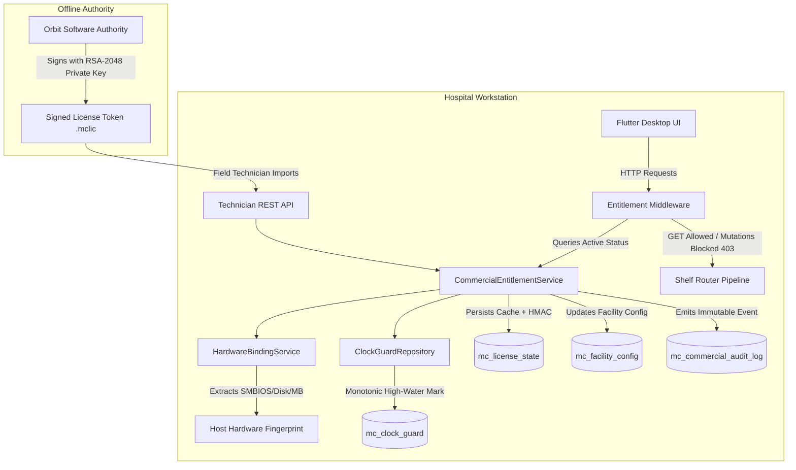
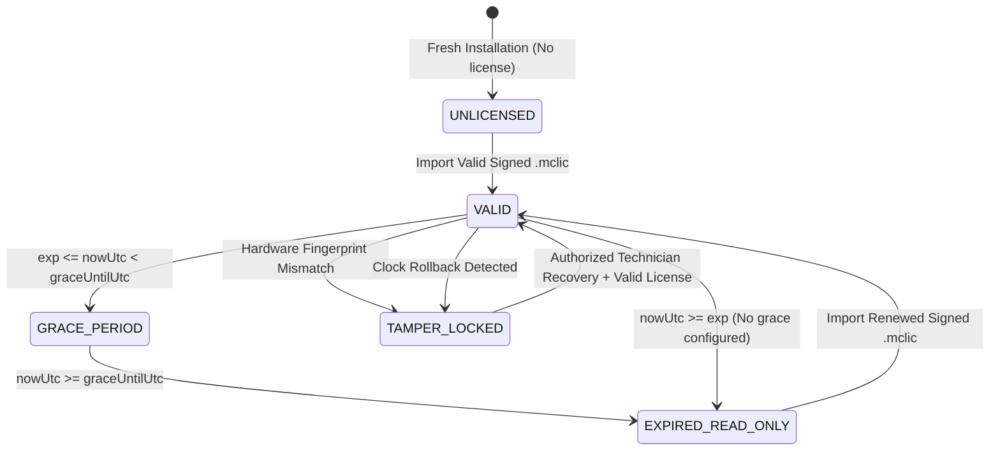

# MEDCORE PLATINUM DESKTOP
# COMMERCIAL ENTITLEMENT ARCHITECTURE SPECIFICATION
## SYSTEM ARCHITECTURE, DOMAIN MODEL & 18-LAYER TRUTH LINEAGE (RUN #14/15)

**Project:** MedCore Platinum Desktop  
**Date:** October 30, 2026  
**Governance:** Khaled Universal Engineering Constitution (Gate 2 & Gate 14)  

---

## 1. ARCHITECTURAL OVERVIEW & DOMAIN MODEL

The Commercial Entitlement Subsystem governs software license validity, edition feature entitlement, hardware machine binding, and operational mutation rights across all hospital workstations.



---

## 2. ENTITLEMENT STATE MACHINE

The active commercial entitlement status transitions through an explicit, deterministic state machine:



### Entitlement Status Definitions:
- `VALID`: Full access. All entitled modules and data mutations (POST, PUT, DELETE) permitted.
- `GRACE_PERIOD`: 14-day operational grace period. System issues clinical renewal warnings while permitting mutations.
- `EXPIRED_READ_ONLY`: Subscription expired. Patient clinical charts, history, and test reports remain fully accessible for viewing (GET); all mutations blocked fail-closed with HTTP 403 `SUBSCRIPTION_EXPIRED`.
- `UNLICENSED`: No license found. Operates in restricted evaluation mode.
- `TAMPER_LOCKED`: Clock tampering or hardware piracy detected. All mutations blocked immediately.

---

## 3. KHALED 18-LAYER TRUTH LINEAGE

Every commercial entitlement mutation follows the complete 18-layer truth path without gaps:

```text
Layer 1:  [USER / TECHNICIAN]           Field technician initiates license update with token file.
Layer 2:  [UI COMPONENT]               Technician Commissioning Workspace / Desktop Client UI.
Layer 3:  [LOCAL CLIENT STATE]         Client memory buffers license string without local authority.
Layer 4:  [CLIENT API CLIENT]          HTTP client constructs multipart/JSON import request.
Layer 5:  [WIRE TRANSPORT / HTTP]      Loopback HTTP transport over 127.0.0.1:8443.
Layer 6:  [AUTHENTICATION]             Shelf pipeline verifies X-MedCore-Tech-Token against active session.
Layer 7:  [AUTHORIZATION]              Technician role verified for technician endpoint scope.
Layer 8:  [TENANT / SECURITY CONTEXT]  Hospital code extracted from verified session; tenant isolation asserted.
Layer 9:  [INPUT VALIDATION]           SignedLicenseToken.parse validates 3 dot-delimited segments and base64url.
Layer 10: [BUSINESS LOGIC]             CommercialEntitlementService verifies RSA-2048 signature & hardware.
Layer 11: [DATABASE TRANSACTION]       TransactionManager begins ACID transaction (Isolation: REPEATABLE READ).
Layer 12: [REPOSITORY / ORM]           Database queries execute parameterized SQL with bound parameters.
Layer 13: [STORAGE ENGINE]             MariaDB InnoDB storage engine acquires row-level locks on mc_license_state.
Layer 14: [PHYSICAL COMMIT]            Transaction commits changes to InnoDB redo log and tablespace.
Layer 15: [HTTP WIRE RESPONSE]         HTTP 200 JSON payload returned with updated entitlement status.
Layer 16: [INDEPENDENT READ-BACK]      Subsequent queries re-read authoritative state directly from MariaDB.
Layer 17: [CLIENT REHYDRATION]         Flutter desktop client refreshes license banner and active status.
Layer 18: [AUDIT LOG COMMIT]           Immutable event committed to mc_commercial_audit_log table.
```

---

## 4. DATABASE REIFICATION & SCHEMA DDL

### Schema Changes in Migration V018:

```sql
-- 1. mc_license_state Extensions
ALTER TABLE mc_license_state
    MODIFY COLUMN ed25519_signature VARCHAR(512) NOT NULL,
    ADD COLUMN IF NOT EXISTS installation_id VARCHAR(128) NOT NULL DEFAULT '' AFTER license_id,
    ADD COLUMN IF NOT EXISTS hardware_fingerprint_sha256 VARCHAR(64) NOT NULL DEFAULT '' AFTER installation_id,
    ADD COLUMN IF NOT EXISTS maintenance_expires_at_utc DATETIME NOT NULL DEFAULT '2026-12-31 23:59:59' AFTER offline_grace_until_utc,
    ADD COLUMN IF NOT EXISTS hmac_seal CHAR(64) NOT NULL DEFAULT '' AFTER ed25519_signature;

-- 2. mc_facility_config Extensions
ALTER TABLE mc_facility_config
    ADD COLUMN IF NOT EXISTS license_id VARCHAR(128) NULL AFTER branch_code,
    ADD COLUMN IF NOT EXISTS entitlement_status VARCHAR(32) NOT NULL DEFAULT 'VALID' AFTER edition,
    ADD COLUMN IF NOT EXISTS hmac_seal CHAR(64) NOT NULL DEFAULT '' AFTER remote_hybrid_config_json;

-- 3. Dedicated Immutable Commercial Audit Log
CREATE TABLE IF NOT EXISTS mc_commercial_audit_log (
    id BIGINT UNSIGNED AUTO_INCREMENT PRIMARY KEY,
    hospital_code VARCHAR(64) NOT NULL,
    license_id VARCHAR(128) NULL,
    event_type VARCHAR(64) NOT NULL,
    severity VARCHAR(32) NOT NULL DEFAULT 'INFO',
    details_json LONGTEXT NOT NULL,
    created_at DATETIME(3) NOT NULL DEFAULT CURRENT_TIMESTAMP(3),
    INDEX idx_mc_comm_audit_hosp_event (hospital_code, event_type),
    INDEX idx_mc_comm_audit_created (created_at)
) ENGINE=InnoDB DEFAULT CHARSET=utf8mb4 COLLATE=utf8mb4_unicode_ci;
```

---

## 5. ARCHITECTURAL INVARIANTS SUMMARY

1. **RSA-2048 Asymmetric Authority Separation**: Orbit Software retains the private authority key. Desktop clients and local service daemons contain strictly the public verification parameters.
2. **Deterministic Fail-Closed Behavior**: When any security parameter is missing, expired, corrupted, or mismatched, the system transitions to `EXPIRED_READ_ONLY` or `TAMPER_LOCKED`.
3. **Clinical Safety Supremacy**: In no circumstance does license expiration prevent viewing patient clinical records. Read queries remain active for emergency patient care.
