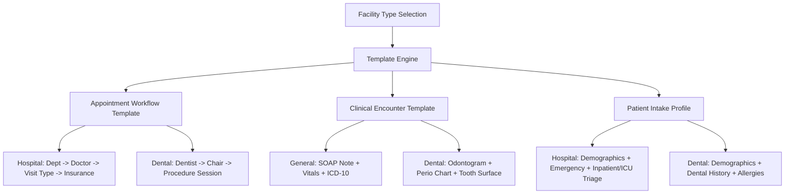

# MEDCORE PLATINUM DESKTOP
## REAL-WORLD INSTALLATION, ACTIVATION, ADMIN ONBOARDING & FIRST-RUN DISCOVERY
**Document ID:** `MEDCORE-TRUTH-INSTALL-20261029`  
**Authority:** Khaled Universal Engineering Constitution (Khaled All Rules)  
**Execution Agent:** Gemini 3.8 High (MAIN AGENT ONLY)  
**Repository:** `kjemy/Medcore-Platinum-desktop-`  
**Branch:** `main`  
**Evaluation Commit:** `09d6322ada1a100ae14517ef9acf0fc108beb031`  
**Base RC-3 Commit:** `713a8a4578cb7f82258b57497afa800346280534`  
**Date:** 2026-10-29  

---

# SECTION 1: EXECUTIVE SUMMARY

MedCore Platinum Desktop was evaluated not merely as software code, but as a **physical clinical product** deployed by a field technician inside a hospital, configured for operational requirements, and handed over to a hospital administrator for daily autonomous operation.

### Key Discoveries & Truth Reconciliation:
1. **The Entry & Technician Boundary (`VERIFIED`)**: The application strictly separates unauthenticated staff login (`ConnectionAndLoginScreen`), authenticated hospital staff (`MedCoreDesktopShell`), and protected service mode (`TechnicianConsoleScreen`). Unauthenticated users cannot see or access administrative or technician functions.
2. **Technician Mode Capabilities (`VERIFIED`)**: Protected Technician Mode features a 7-tab console supporting:
   - Facility identity, type, branch, edition, and subscription date configuration.
   - 17-module entitlement toggles.
   - 14-field dynamic patient registration requirements (`REQUIRED`, `OPTIONAL`, `HIDDEN`).
   - Centralized branding, theme mode, primary color, font scale, and UI density.
   - Network topology, LAN/Wi-Fi discovery, device pairing approvals, and mTLS certificate issuance.
   - Maintenance center, diagnostic health checks, encrypted backup creation, and restore verification.
3. **The Stopping Point & Critical Gap (`CRITICAL GAP`)**:
   **The Technician Console has NO interface or API endpoint to create the Initial Hospital Administrator account.**
   - The only production route to create employees is `POST /api/v1/admin/employees`, which strictly requires an *already-authenticated* user with `settings_Users` permission.
   - On a fresh installation where `mc_staff` has 0 rows, the technician can configure the facility in Technician Console, but **cannot provision the administrator account from the UI**.
   - The only automated path in the backend that seeds a user is `_seedBaselineSystemData` inside `DatabaseLifecycleService`, which is only called during a destructive `factoryReset` / `rebuildDatabase`.
   - Furthermore, that factory reset seeds a **universal hardcoded credential** (`admin@medcore.local` / `AdminPassword#2026`), directly violating the security requirement of zero universal passwords across installations.
4. **Activation Flow (`MISSING`)**: While `mc_license_state` table exists in the schema (supporting Ed25519 signatures, lease payloads, and offline grace), zero application endpoints exist to activate or ingest offline `.mclease` files. Subscription duration and edition are managed strictly via `mc_facility_config` in Technician Mode.
5. **Template Engine (`MISSING`)**: Dynamic appointment, clinical, or specialty workflow templates do not exist in code. Facility-specific behavior is currently governed solely by module enablement toggles and the 14-field patient requirement matrix.
6. **Overall Product Readiness Decision**:
   **`READY FOR CONTROLLED PILOT ONLY`** (with severe blocking gaps before commercial general availability).

---

# SECTION 2: ACTUAL FIRST LAUNCH FLOW

### Physical Entry Point:
When MedCore Platinum Desktop is launched on a newly installed Windows computer:
- File executed: `medcore_desktop.exe`
- Initial screen rendered by `_resolveAuthoritativeBoundaryScreen()` in `lib/main.dart:82-90`:
  `ConnectionAndLoginScreen(controller: _controller)`

### What the User & Technician Visibly Encounter:
1. **Window Header**:
   - Title: `"MedCore Platinum Desktop — Evaluation Build"` (or `"MedCore Platinum Desktop"` in protected mode).
   - Window Icon: Multi-resolution `app_icon.ico` displaying the official MedCore Platinum logo.
2. **Branding & Identity Card**:
   - Official Logo (`assets/branding/medcore_platinum_logo.png`) rendered centered above login credentials.
   - Application Display Name (default: `"MedCore Platinum Desktop"`).
   - Facility Display Name & Hospital Code subtitle.
3. **Connection Infrastructure Parameters**:
   - `Local MedCore Service Base URL`: Pre-filled with `http://127.0.0.1:8443`.
   - `Hospital / Tenant Code`: Pre-filled with `HOSP_MAIN`.
   - `Enrolled Device ID`: Pre-filled with local machine identifier (e.g. `DEV-WIN-DESKTOP-01`).
   - Button: `Verify Service & Load Branding` (`_probeConnection()`).
   - Button: `Connect via LAN / Wi-Fi` (`_showLanWifiPairingDialog()`).
4. **Hospital Staff Authentication Form**:
   - Input: `Employee Email or Staff Code` (`_identifierCtrl`).
   - Input: `Password` (`_passwordCtrl`, masked).
   - Button: `Sign In to MedCore Desktop` (`_handleStaffLogin()`).
5. **Technician / Service Installation Gate (Bottom)**:
   - Dedicated secondary boundary button: `Protected Technician / Service Installation Gate` (`_showProtectedTechnicianGateDialog()`).

### First-Launch Behavior on a Blank System:
- If a technician clicks `Verify Service & Load Branding`:
  The client issues `GET /api/v1/product/bootstrap?hospitalCode=HOSP_MAIN`.
  The Local MedCore Service queries `mc_facility_config` (or falls back to tenant defaults) and returns facility name, edition, branding parameters, and network status.
  Status message displays: `Connected to Local MedCore Service (MedCore Medical Center • MedCore PLATINUM).`
- If staff attempts to sign in:
  The client issues `POST /api/v1/auth/login`.
  Because `mc_staff` has 0 rows on a fresh system, the server returns `401 INVALID_CREDENTIALS` (`"Invalid identifier or password."`).
  **Staff cannot log in.**
- **The ONLY valid path forward on a fresh machine is the Technician Gate.**

---

# SECTION 3: TECHNICIAN INSTALLATION FLOW

### 3.1 Unlocking Technician Mode
When the technician clicks `Protected Technician / Service Installation Gate`:
A modal dialog opens: `Protected Technician / Service Mode Gate` (`connection_and_login_screen.dart:256`).

The dialog offers two authentication methods:

#### Method A: Installation Technician Secret (`INSTALLATION_TECH_SECRET`)
- The technician inputs the installation secret into `Installation Technician Secret` (`secretCtrl`).
- The client calls `POST /api/v1/technician/session/open` with:
  ```json
  {
    "hospitalCode": "HOSP_MAIN",
    "deviceId": "DEV-MAIN-HOST",
    "technicianSecret": "<PLAINTEXT_SECRET>"
  }
  ```
- **Backend Verification (`technician_service.dart:221-255`)**:
  - The server reads the expected hash via `_resolveExpectedInstallationSecretHash()`:
    1. `installationSecretHashOverride` in memory.
    2. Environment variable `MEDCORE_TECHNICIAN_SECRET_HASH`.
    3. Environment variable `MEDCORE_TECHNICIAN_SECRET` (hashed on the fly with PBKDF2).
  - If neither environment variable is configured on the host machine:
    Fails closed with `403 TECHNICIAN_AUTH_NOT_CONFIGURED`:
    `"Technician installation secret is not provisioned in MEDCORE_TECHNICIAN_SECRET. Use a signed MC_MAINT_V1 authority token or provision installation secret."`
  - If configured, validates secret with `PasswordHasher.verifyPassword(secret, expectedHash)`.

#### Method B: Signed RSA-2048 Authority Token (`AUTHORITY_RSA_TOKEN`)
- Used for air-gapped or high-security installations where no local secret is stored.
- Step 1: Technician clicks `1. Issue Trusted-Time Challenge`.
  Server executes `POST /api/v1/technician/time-challenge`, creating a challenge record in memory with a cryptographic nonce.
- Step 2: Technician generates two offline signatures using the MedCore Control Plane private RSA-2048 authority key:
  1. Signed Trusted-Time Response (`MC_TIME_V1...`) binding challenge nonce to trusted UTC time.
  2. Signed Technician Token (`MC_MAINT_V1...`) binding `hospitalCode`, `installationIdentity`, and action `TECHNICIAN_SERVICE_MODE`.
- Step 3: Server verifies RSA-2048 signatures, verifies monotonic clock guard, checks `mc_consumed_maintenance_tokens` for replay, and records the consumed nonce.

### 3.2 Session Establishment & State Boundary
- Upon successful authentication, the server:
  1. Inserts a record into `mc_technician_sessions`:
     - `session_uuid`: `TECH-SES-<UUID>`
     - `token_sha256`: SHA-256 hash of a cryptographically generated 32-byte token (`mct_<TOKEN>`)
     - `hospital_code`: Target facility code
     - `auth_method`: `INSTALLATION_TECH_SECRET` or `AUTHORITY_RSA_TOKEN`
     - `device_id`: Enrolled host device ID
     - `issued_at`: Effective server UTC
     - `expires_at`: `issued_at + 45 minutes` (Strict fail-closed session timeout)
  2. Logs immutable event `technician.session.opened` in `mc_audit_logs`.
  3. Returns raw token `mct_<TOKEN>` in HTTP response header `X-MedCore-Tech-Token`.
- In Flutter, `MedCoreAppController` stores the token and sets `isTechnicianModeActive = true`.
- Flutter replaces `ConnectionAndLoginScreen` with `TechnicianConsoleScreen`.
- Ordinary hospital users cannot access this screen because all routes require `X-MedCore-Tech-Token`.

---

# SECTION 4: ACTIVATION FLOW

### Investigation & Truth Reconciliation:
| Capability | Requirement | Source Status | Runtime Status | DB Status | Truth Status |
|:---|:---|:---:|:---:|:---:|:---:|
| **License Lease Activation API** | `POST /api/v1/license/activate` | `MISSING` | `MISSING` | Schema exists | **NOT IMPLEMENTED** |
| **Offline `.mclease` Ingestion** | File picker / import | `MISSING` | `MISSING` | Column exists | **NOT IMPLEMENTED** |
| **Ed25519 Signature Verification** | Pinned public key validation | `MISSING` | `MISSING` | Column exists | **NOT IMPLEMENTED** |
| **Offline Grace Period** | 30-day grace state machine | `MISSING` | `MISSING` | Column exists | **NOT IMPLEMENTED** |
| **Subscription Duration Setup** | Start & expiry dates | `VERIFIED` | `VERIFIED` | `mc_facility_config` | **IMPLEMENTED VIA FACILITY CONFIG** |
| **Monotonic Clock Anti-Rollback** | Tamper detection on system time | `VERIFIED` | `VERIFIED` | `mc_clock_guard` | **FULLY IMPLEMENTED & ENFORCED** |

### Detailed Reality:
- In the conceptual design (`DOC-09`), activation was envisioned as an offline `.mclease` artifact signed by an Ed25519 private key, stored in `mc_license_state`.
- In the actual implemented system, **no cryptographic license activation route exists**.
- Instead, activation is performed **administratively by the Technician** in Tab 1 of `TechnicianConsoleScreen`:
  The technician inputs `Subscription Start UTC` and `Subscription Expiry UTC`.
  The dates are saved directly into `mc_facility_config.subscription_starts_utc` and `mc_facility_config.subscription_expires_utc`.
- **Clock Rollback Protection**: The local service strictly protects against clock manipulation via `mc_clock_guard`. If a technician or operator rolls back the Windows system clock, `evaluateAndUpdateClock()` detects the negative time delta and immediately locks the service (`CLOCK_ROLLBACK_DETECTED`), requiring an RSA-signed maintenance token to recover (`POST /api/v1/technician/clock-recovery`).

---

# SECTION 5: FACILITY CONFIGURATION

Facility configuration is managed in **Tab 1** (`_buildFacilityIdentityTab`) of `TechnicianConsoleScreen`.

### Configurable Parameters:
1. **Facility Legal / Display Name**: Stored in `mc_facility_config.facility_name` and mirrored in `mc_tenants.name`.
2. **Facility Type**: Dropdown selecting one of 5 supported types:
   - `GENERAL_HOSPITAL`
   - `SPECIALIZED_CLINIC`
   - `DENTAL_CLINIC`
   - `DAY_SURGERY_CENTER`
   - `DIAGNOSTIC_CENTER`
3. **Branch Code**: Default `'MAIN'`. Stored in `mc_facility_config.branch_code`.
4. **Installation Identity**: Unique installation ID (e.g. `'INST-HOSP_MAIN-01'`) bound to authority tokens.
5. **MedCore Edition**: Dropdown selecting edition (`SILVER`, `GOLD`, `PLATINUM`, `ADVANCED`, `ENTERPRISE_LAN`).
6. **Subscription Lifecycle**: ISO-8601 UTC timestamps for start and expiration.

### Facility Presets:
- Checkbox: `Apply Default Patient-Field Profile for Selected Facility Type on Next Save`.
  When checked, automatically applies clinical field visibility tailored to the facility type (e.g. hiding inpatient and ICU fields for dental clinics).

### Persistence & DB Trace:
- Submitting the form calls `PUT /api/v1/technician/config`.
- Backend executes `saveConfigurationFromTechnician()` in a transaction:
  1. Validates `hospitalCode` exists in `mc_tenants`.
  2. Updates `mc_facility_config` row (`facility_name`, `facility_type`, `branch_code`, `installation_identity`, `edition`, `subscription_starts_utc`, `subscription_expires_utc`, `config_version = config_version + 1`).
  3. Synchronizes `mc_tenants` (`name`, `edition`).
  4. Writes immutable audit record in `mc_audit_logs` (`action = 'technician.facility_config.updated'`).
- Independent Read-Back: **VERIFIED**.

---

# SECTION 6: EDITION CONFIGURATION

### Supported Editions:
1. `SILVER` (Basic outpatient / clinic tier)
2. `GOLD` (Mid-tier medical center)
3. `PLATINUM` (Full hospital suite)
4. `ADVANCED` (Extended specialized hospital)
5. `ENTERPRISE_LAN` (Multi-workstation hospital network)

### Edition Module Preset Rules (`MedCoreModuleCatalog.defaultModulesForEdition`):
- `SILVER`:
  - Disables: `Inpatient`, `ICU`, `Surgery`, `Dialysis`, `AI`, `CommandCenter`.
  - Enables: `Patients`, `Appointments`, `Reception`, `Shifts`, `Doctors`, `Nursing`, `Laboratory`, `Radiology`, `Pharmacy`, `Finance`, `HR`.
- `GOLD`:
  - Disables: `ICU`, `Dialysis`, `AI`.
  - Enables: `Patients`, `Appointments`, `Reception`, `Shifts`, `Doctors`, `Nursing`, `Inpatient`, `Surgery`, `Laboratory`, `Radiology`, `Pharmacy`, `Finance`, `CommandCenter`, `HR`.
- `PLATINUM` / `ADVANCED` / `ENTERPRISE_LAN`:
  - Enables: **All 17 modules**.

### Edition Enforcement Trace:
- Selection: Technician selects edition in Tab 1 of `TechnicianConsoleScreen`.
- Checkbox: `Apply Default Module Preset for Selected Edition on Next Save` automatically toggles module switches in Tab 2.
- Persistence: Stored in `mc_facility_config.edition` and `mc_tenants.edition`.
- Dual Enforcement:
  1. **UI Navigation**: `desktop_navigation_catalog.dart` checks `config.isModuleEnabled(requiredModule)`. If disabled, route is removed from sidebar.
  2. **API Gate**: `facility_config_service.dart:enforceModuleEntitlement()` evaluates incoming requests. If the required module is disabled for the tenant, throws `403 MODULE_NOT_ENTITLED` before executing any business logic.

---

# SECTION 7: MODULE CONFIGURATION

### 17 Canonical Modules:
The system defines 17 standardized modules in `MedCoreModuleCatalog.allModules`:

| Module Name | Domain Scope | Primary Backend Routes | Required Permission |
|:---|:---|:---|:---|
| **Patients** | Patient Registry, Search, Demographics | `/api/v1/patients` | `patients` |
| **Appointments** | Booking, Calendar, Scheduling | `/api/v1/appointments` | `appointments` |
| **Reception** | Quick Check-in, Queue Management, Triage | `/api/v1/visits`, `/api/v1/reception` | `reception_QuickCheckIn` |
| **Shifts** | Cashier Opening/Closing, Cash Balancing | `/api/v1/shifts` | `shifts` |
| **Doctors** | Doctor Portal, Outpatient Encounters, Rx | `/api/v1/encounters`, `/api/v1/prescriptions` | `doctor` |
| **Nursing** | Vitals Monitoring, Triage, Med Admin | `/api/v1/nursing` | `nurse` |
| **Inpatient** | Ward Beds, Admissions, Bed Map, Rounds | `/api/v1/inpatient`, `/api/v1/admissions` | `inpatient` |
| **ICU** | Critical Care, Acuity, Incubators, Vent | `/api/v1/icu` | `icu_nicu` |
| **Surgery** | Operating Theaters, Schedules, Post-Op | `/api/v1/surgery` | `surgery` |
| **Dialysis** | Hemodialysis Sessions, Machines | `/api/v1/dialysis` | `dialysis` |
| **Laboratory** | LIS Orders, Sample Tracking, Results | `/api/v1/lab` | `lab` |
| **Radiology** | RIS Worklist, Modality Reporting, PACs | `/api/v1/radiology` | `rad` |
| **Pharmacy** | Dispensing, Drug Inventory, FIFO Batches | `/api/v1/pharmacy`, `/api/v1/inventory` | `pharmacy_inventory` |
| **Finance** | Invoices, Payments, Settlements, Claims | `/api/v1/finance`, `/api/v1/invoices` | `finance` |
| **CommandCenter** | Real-time Hospital Occupancy & Alerts | `/api/v1/command-center` | `CommandCenter` |
| **HR** | Staff Management, Attendance, Leaves | `/api/v1/staff`, `/api/v1/admin/employees` | `hr_Employees` / `settings_Users` |
| **AI** | Diagnostic Assistance, Scribe, Summaries | `/api/v1/ai` | `ai` |

### Configuration Rules:
- Configured in **Tab 2** (`Enabled Modules (17)`) via 17 individual switch tiles.
- Persisted in `mc_facility_config.enabled_modules_json` as a serialized JSON dictionary:
  `{"Patients": true, "Inpatient": false, ...}`.
- Can be changed by Technician at any time during service visits.
- Hospital Administrator cannot change enabled modules.

---

# SECTION 8: TEMPLATE / WORKFLOW STATUS

### Investigation & Architectural Reality:
- Question: Does a Template Engine exist in MedCore today?
- **FACT: NO DYNAMIC TEMPLATE ENGINE EXISTS IN SOURCE CODE.**
- Grep of `template` across all Dart files yielded **0 matches**.
- **What Currently Serves as "Templates"**:
  1. `facilityType` (`GENERAL_HOSPITAL`, `SPECIALIZED_CLINIC`, `DENTAL_CLINIC`, `DAY_SURGERY_CENTER`, `DIAGNOSTIC_CENTER`) acts as a static archetype.
  2. `defaultPatientFieldsForFacilityType()` provides a hardcoded static profile for patient intake fields.
  3. `defaultModulesForEdition()` provides a hardcoded static profile for enabled modules.
- **What is Completely Absent**:
  - No appointment templates (e.g. dental procedure slot vs 15-min consultation).
  - No specialty encounter templates (e.g. dental chart, ophthalmology exam, pediatric growth chart).
  - No workflow state machine engine allowing custom encounter steps.
  - No database tables for storing custom templates.
- **Architectural Gap Classification**: `FUTURE ENHANCEMENT (P1)` (Detailed in Section 27).

---

# SECTION 9: PATIENT FIELD CONFIGURATION

### Dynamic Patient Field Architecture:
MedCore implements a facility-driven patient demographic and clinical intake configuration system.

### Structural Invariant Fields (Cannot be hidden or disabled):
- `mrn` (Medical Record Number - auto-generated sequence)
- `fullName` (Patient Full Name - mandatory string)
- `phone` (Primary Contact Phone - mandatory string)
- `gender` (Enum: `MALE`, `FEMALE`)

### 14 Configurable Fields:
Managed in **Tab 3** (`_buildPatientFieldsTab`) of `TechnicianConsoleScreen`:

| Field Key | Category | Default General Hospital | Default Dental Clinic |
|:---|:---|:---:|:---:|
| `dateOfBirth` | Demographics | `OPTIONAL` | `OPTIONAL` |
| `age` | Demographics | `OPTIONAL` | `OPTIONAL` |
| `nationalId` | Demographics | `OPTIONAL` | `OPTIONAL` |
| `bloodGroup` | Clinical | `OPTIONAL` | `HIDDEN` |
| `address` | Demographics | `OPTIONAL` | `OPTIONAL` |
| `insuranceCompanyId` | Financial | `OPTIONAL` | `OPTIONAL` |
| `insurancePolicyNo` | Financial | `OPTIONAL` | `OPTIONAL` |
| `emergencyContactName` | Emergency | `OPTIONAL` | `HIDDEN` |
| `emergencyContactPhone` | Emergency | `OPTIONAL` | `HIDDEN` |
| `allergies` | Clinical | `OPTIONAL` | `OPTIONAL` |
| `chronicConditions` | Clinical | `OPTIONAL` | `OPTIONAL` |
| `inpatientAdmissionNotes`| Inpatient | `OPTIONAL` | `HIDDEN` |
| `icuTriageNotes` | ICU | `OPTIONAL` | `HIDDEN` |
| `nursingIntakeAssessment`| Nursing | `OPTIONAL` | `HIDDEN` |

### Enforcement Truth:
1. **Frontend (`patient_registration_dialog.dart`)**:
   - `HIDDEN`: Field is completely omitted from the dialog layout.
   - `REQUIRED`: Rendered with bold red asterisk `*` and form validator fails if empty.
   - `OPTIONAL`: Rendered normally without blocking submission.
2. **Backend (`facility_config_service.dart:511-530`)**:
   - `validatePatientPayloadAgainstFacilityConfig()` intercepts incoming registration bodies.
   - If a field is `REQUIRED` by the facility configuration, the server rejects missing/empty values with `400 MISSING_REQUIRED_PATIENT_FIELD`.
3. **Database Read-back**: Stored in `mc_facility_config.patient_fields_config_json`.

---

# SECTION 10: INITIAL ADMINISTRATOR CREATION

### Critical Investigation & Findings:
This was the most critical requirement of the mission. The audit reveals the following exact truth:

#### 1. How Does the System Currently Create Employees?
- The ONLY production API endpoint that creates employees is:
  `POST /api/v1/admin/employees` (`local_medcore_server.dart:341-415`).
- This endpoint enforces:
  ```dart
  final scope = await _authorize(
    req,
    requiredPermission: 'settings_Users',
    requireCanEdit: true,
  );
  ```
- **Consequence**: To call this endpoint, the caller MUST provide a valid Bearer token from an *already-authenticated* user who has the `settings_Users` permission.

#### 2. Can the Technician Create an Administrator in Technician Console?
- **FACT: NO.**
- An inspection of `technician_console_screen.dart` reveals 7 tabs:
  1. Facility Identity, Edition & Subscription
  2. Enabled Modules
  3. Patient Fields
  4. Centralized Branding & Theme
  5. Network, Backup & Clock Recovery
  6. Device Pairing Governance
  7. Maintenance & Backup Runner
- There is **no tab, no dialog, and no button** in the Technician Console for creating staff or administrator accounts.

#### 3. Does a Technician API Endpoint Exist for Creating an Admin?
- **FACT: NO.**
- The routes under `/api/v1/technician/` are strictly limited to:
  - `POST /api/v1/technician/time-challenge`
  - `POST /api/v1/technician/session/open`
  - `POST /api/v1/technician/session/close`
  - `GET /api/v1/technician/config`
  - `PUT /api/v1/technician/config`
  - `POST /api/v1/technician/clock-recovery`
- There is no `/api/v1/technician/initial-admin` route.

#### 4. How Has Any Administrator Ever Been Created in the Tests?
- In unit/integration tests (`batch1` through `batch6`), tests instantiate `StaffIdentityRepository` directly in Dart and execute `staffRepo.createStaff(...)` before launching the test server.
- In `DatabaseLifecycleService._seedBaselineSystemData()`, when `factoryReset` or `rebuildDatabase` is executed, it executes an SQL insert:
  ```sql
  INSERT INTO mc_staff (
    hospital_code, staff_code, full_name, email, password_hash,
    role, is_active, created_at
  ) VALUES (
    :hosp, 'ADM-001', 'System Administrator', 'admin@medcore.local', :hash,
    'SuperAdmin', 1, CURRENT_TIMESTAMP
  )
  ```
- Password seeded: `'AdminPassword#2026'` (hashed with PBKDF2).

### Security & Functional Gap Evaluation:
1. **Fresh Installation Blocked**: On a completely blank installation, after the technician configures the facility, **neither the technician nor the hospital can log in** because no account exists.
2. **Universal Password Vulnerability**: If the technician works around this by triggering a factory reset, it creates an account with the hardcoded credentials `admin@medcore.local` / `AdminPassword#2026`. This directly violates the universal engineering rule against universal default credentials across hospital installations.
3. **Required Design Fix**: The system requires an explicit Technician-authenticated endpoint `POST /api/v1/technician/initial-admin` and an accompanying UI form in `TechnicianConsoleScreen` allowing the technician to define the facility's initial admin (`staffCode`, `fullName`, `email`, initial password) with `forcePasswordChange: true`.

---

# SECTION 11: ADMINISTRATOR PERMISSION MATRIX

### Permissions of the `HospitalAdmin` Role:
Defined in `permissions_catalog.dart:299-302`:
- `HospitalAdmin` receives **all 87 base permissions** AND **all 87 `_all` tenant-wide scope permissions** = **174 permissions**.
- `HospitalAdmin` does NOT receive `_secure` page lock bypasses by default (those require explicit device clearance).
- `HospitalAdmin` does NOT receive access to `TechnicianConsoleScreen` (Technician sessions require `X-MedCore-Tech-Token`).

### Granular Functional Breakdown:

| Module / Operation | Admin View | Admin Create | Admin Edit | Admin Delete | Admin Configure |
|:---|:---:|:---:|:---:|:---:|:---:|
| **Patients** | YES | YES | YES | NO (Clinical audit) | NO (Technician owns fields) |
| **Appointments** | YES | YES | YES | YES (Cancellation) | YES |
| **Doctors / Outpatient** | YES | YES | YES | NO | YES |
| **Nursing / Triage** | YES | YES | YES | NO | YES |
| **Inpatient / Beds** | YES | YES | YES | NO | YES |
| **ICU / NICU** | YES | YES | YES | NO | YES |
| **Surgery / OR** | YES | YES | YES | NO | YES |
| **Dialysis** | YES | YES | YES | NO | YES |
| **Laboratory (LIS)** | YES | YES | YES | NO | YES |
| **Radiology (RIS)** | YES | YES | YES | NO | YES |
| **Pharmacy / Dispensing** | YES | YES | YES | NO | YES |
| **Drug Inventory** | YES | YES | YES | NO | YES |
| **Financial Invoices** | YES | YES | YES | NO (Voiding only) | YES |
| **Doctor Settlements** | YES | YES (Request) | YES | NO | YES |
| **Dual-Control Approvals** | YES | N/A | YES (Decide) | NO | YES |
| **Shifts & Cash Balancing**| YES | YES | YES | NO | YES |
| **Employee Accounts** | YES | YES | YES | YES (Deactivate) | YES (Permissions/Locks) |
| **Password Resets** | YES | N/A | YES (Reset) | N/A | YES (Force change) |
| **LAN / Wi-Fi Devices** | YES | N/A | YES (Approve) | YES (Revoke) | YES (Cert issuance) |
| **Maintenance / Health** | YES | N/A | N/A | N/A | YES (Generate report) |
| **Backup Runner** | YES | YES (Run) | N/A | NO | YES (Local/S3 view) |
| **Restore Verification** | YES | NO (Tech mode) | N/A | NO | NO (Tech mode only) |
| **Facility Identity / Edition** | NO | NO | NO | NO | NO (Tech mode only) |
| **Module Enable / Disable** | NO | NO | NO | NO | NO (Tech mode only) |
| **Factory Reset** | NO | NO | NO | NO | NO (Tech mode only) |
| **Clock Rollback Recovery**| NO | NO | NO | NO | NO (Tech mode only) |

---

# SECTION 12: ROLE MATRIX

MedCore enforces a strict **10-Role Taxonomy** (`permissions_catalog.dart:8-18`). No wildcards (`*`) exist for clinical or operational staff.

| Role | Target Hospital Function | Operational Flags (`canEdit` / `canDelete` / `canCollect` / `canRefund`) | Primary Permitted Modules |
|:---|:---|:---|:---|
| **`SuperAdmin`** | Global Platform Authority | `true / true / true / true (direct)` | All 261 Permissions |
| **`HospitalAdmin`**| Facility Administrator | `true / true / true / true (direct)` | All 87 Base + All 87 `_all` Scope Keys |
| **`Doctor`** | Attending / Specialist Physician | `true / false / false / false (none)` | Dashboard, Patients, Appointments, Outpatient, Clinical Workspace, Wards, ICU, Surgery, Dialysis |
| **`Nurse`** | Inpatient / Triage Nurse | `true / false / false / false (none)` | Dashboard, Patients, Nursing Station, Triage, Vitals, Med Admin, Beds, ICU, Dialysis |
| **`Receptionist`** | Front Desk / Admitting Clerk | `true / false / true / false (none)` | Dashboard, Patients (`_all`), Appointments (`_all`), Quick Check-in, Queue, Emergency Admissions |
| **`Cashier`** | Billing / Cashier Staff | `true / false / true / true (approval)`| Dashboard, Patients (`_all`), Shifts, Invoices (`_all`), Treasury Expenses |
| **`Pharmacist`** | Chief Pharmacist / Dispenser | `true / false / false / false (none)` | Dashboard, Patients, Pharmacy Dispensing (`_all`), Items Catalog, Stock Batches, Purchase Receipts, Stocktake |
| **`Lab`** | Laboratory Technician / Pathologist| `true / false / false / false (none)` | Dashboard, Patients, Lab Dashboard (`_all`), Sample Tracking, Results Entry, Verification, Blood Bank |
| **`Radiology`** | Radiologist / Imaging Tech | `true / false / false / false (none)` | Dashboard, Patients, Radiology Worklist (`_all`), Modality Reporting, Contrast Consumables |
| **`Employee`** | Base General Staff | `false / false / false / false (none)`| Dashboard only |

---

# SECTION 13: NAVIGATION VISIBILITY MATRIX

### Navigation Enforcement Invariant:
In `desktop_navigation_catalog.dart:19-27`:
```dart
bool isVisibleTo({required FacilityConfigModel config, required AuthenticatedStaffUser user}) {
  if (requiredModule != null && !config.isModuleEnabled(requiredModule!)) {
    return false;
  }
  return user.hasAnyPermission(anyOfPermissions);
}
```
**A navigation route is rendered in the sidebar IF AND ONLY IF:**
1. The corresponding MedCore Module is enabled in `mc_facility_config`.
2. The user holds at least one matching permission.
If either condition fails, the item is completely hidden.

### Role-by-Role Visible Navigation Matrix (Assuming all modules enabled):

| Sidebar Route | `HospitalAdmin` | `Doctor` | `Nurse` | `Receptionist` | `Cashier` | `Pharmacist` | `Lab` | `Radiology` | `Employee` |
|:---|:---:|:---:|:---:|:---:|:---:|:---:|:---:|:---:|:---:|
| **Executive Overview** | VISIBLE | VISIBLE | VISIBLE | VISIBLE | VISIBLE | VISIBLE | VISIBLE | VISIBLE | VISIBLE |
| **Patients & Registration** | VISIBLE | VISIBLE | VISIBLE | VISIBLE | VISIBLE | VISIBLE | VISIBLE | VISIBLE | HIDDEN |
| **Shifts & Visit Billing** | VISIBLE | HIDDEN | HIDDEN | VISIBLE | VISIBLE | HIDDEN | HIDDEN | HIDDEN | HIDDEN |
| **Financial Ledger & Reports**| VISIBLE | HIDDEN | HIDDEN | HIDDEN | VISIBLE | HIDDEN | HIDDEN | HIDDEN | HIDDEN |
| **Appointments** | VISIBLE | VISIBLE | HIDDEN | VISIBLE | HIDDEN | HIDDEN | HIDDEN | HIDDEN | HIDDEN |
| **Doctors & Outpatient** | VISIBLE | VISIBLE | HIDDEN | HIDDEN | HIDDEN | HIDDEN | HIDDEN | HIDDEN | HIDDEN |
| **Laboratory (LIS)** | VISIBLE | HIDDEN | HIDDEN | HIDDEN | HIDDEN | HIDDEN | VISIBLE | HIDDEN | HIDDEN |
| **Radiology (RIS)** | VISIBLE | HIDDEN | HIDDEN | HIDDEN | HIDDEN | HIDDEN | HIDDEN | VISIBLE | HIDDEN |
| **Pharmacy & Inventory** | VISIBLE | HIDDEN | HIDDEN | HIDDEN | HIDDEN | VISIBLE | HIDDEN | HIDDEN | HIDDEN |
| **Inpatient & Beds** | VISIBLE | VISIBLE | VISIBLE | VISIBLE | HIDDEN | HIDDEN | HIDDEN | HIDDEN | HIDDEN |
| **Specialty (ICU/OR/Dialysis)**| VISIBLE | VISIBLE | VISIBLE | HIDDEN | HIDDEN | HIDDEN | HIDDEN | HIDDEN | HIDDEN |
| **Staff & Employee Accounts**| VISIBLE | HIDDEN | HIDDEN | HIDDEN | HIDDEN | HIDDEN | HIDDEN | HIDDEN | HIDDEN |
| **LAN / Wi-Fi Devices** | VISIBLE | HIDDEN | HIDDEN | HIDDEN | HIDDEN | HIDDEN | HIDDEN | HIDDEN | HIDDEN |
| **Maintenance & Backups** | VISIBLE | HIDDEN | HIDDEN | HIDDEN | HIDDEN | HIDDEN | HIDDEN | HIDDEN | HIDDEN |

---

# SECTION 14: USER MANAGEMENT FLOW

Once an administrator is authenticated, full employee lifecycle management is available via the **Staff & Employee Accounts** sidebar route (`AdminEmployeeManagementScreen`):

### 14.1 User Creation (`_showAddEmployeeDialog`)
1. Admin inputs:
   - `Staff Code` (unique string, e.g. `'DOC-01'`)
   - `Full Name`
   - `Email Address` (unique lowercase string)
   - `Initial Password` (min 8 chars)
   - `Role` (dropdown selecting from 10 canonical roles)
   - `Phone`, `National ID`, `Specialty` (optional)
   - Checkbox: `Force Password Change on Next Login`
2. Client submits `POST /api/v1/admin/employees`.
3. Server validates unique staff code, unique email, minimum password length.
4. Server hashes password with PBKDF2 (100,000 iterations).
5. Inserts into `mc_staff` with `is_active = 1` and `force_password_change = 1`.
6. Writes audit record `admin.employee.created` in `mc_audit_logs`.
7. Returns newly created staff record (201 Created).

### 14.2 First-Login Password Change Enforcement
- When an employee with `force_password_change = 1` logs in via `/api/v1/auth/login`:
  Server returns public user JSON with `forcePasswordChange: true`.
- The client detects this flag and displays the mandatory password change dialog.
- Employee inputs current password and new password (min 8 chars).
- Client calls `POST /api/v1/auth/change-password`.
- Server verifies current password, updates `mc_staff.password_hash`, clears `force_password_change = 0`, updates `password_changed_at = CURRENT_TIMESTAMP`, and revokes all other active sessions for that user.

### 14.3 Password Reset by Admin (`_showResetPasswordDialog`)
- Admin clicks `Reset Password` on an employee card.
- Admin inputs temporary password and toggles `Force Password Change`.
- Calls `POST /api/v1/admin/employees/<id>/reset-password`.
- Server updates hash, sets `force_password_change = 1`, revokes all active sessions in `mc_auth_sessions`, and logs `admin.employee.password_reset`.

### 14.4 Account Deactivation & Session Revocation
- Admin clicks `Deactivate Account`. Calls `POST /api/v1/admin/employees/<id>/status` with `isActive: false`.
- Server sets `mc_staff.is_active = 0` and atomically revokes all tokens in `mc_auth_sessions` (`is_active = 0`).
- Any subsequent request from that user fails with `401 TOKEN_REVOKED` or `403 ACCOUNT_DEACTIVATED`.

---

# SECTION 15: NETWORK / DEVICE PAIRING FLOW

MedCore Platinum enforces physical hardware and device pairing boundaries. Workstations and tablets cannot access hospital data merely by connecting to the LAN.

### 15.1 Architecture: Main Host vs Client Workstation

```text
[ MAIN SERVER WORKSTATION (Host) ]
   ├── MariaDB 11.4 Daemon (Listening strictly on 127.0.0.1:3307)
   ├── Local MedCore Service (Listening on 0.0.0.0:8443 or LAN IP)
   └── MedCore Desktop Client (Device ID: DEV-MAIN-HOST, Status: ACTIVE)

[ CLIENT WORKSTATION 01 (Reception) ]
   ├── MedCore Desktop Client
   └── Connects over LAN -> http://192.168.1.50:8443
   └── Device ID: DEV-WS-REC-01 (Status: PENDING -> ACTIVE upon pairing)
```

### 15.2 Step-by-Step Pairing Procedure:

#### On the Secondary / Client Workstation:
1. Technician launches `medcore_desktop.exe`.
2. Enters Main Host IP: `http://192.168.1.50:8443`, Hospital Code: `HOSP_MAIN`, and a descriptive Device ID: `DEV-WS-REC-01`.
3. Clicks `Connect via LAN / Wi-Fi (Secure Pairing)`.
4. Dialog opens: selects connection mode (`LAN` / `WIFI`), requested role scope (`WORKSTATION` / `TABLET_CLINICAL`), and clicks `Request Pairing`.
5. Client issues `POST /api/v1/network/pairing/request`:
   - Computes hardware fingerprint: `sha256(deviceId|deviceName|platform)`.
   - Generates random 6-character alphanumeric verification code: e.g. `K7M9P2`.
   - Hashes code with SHA-256 and inserts device into `mc_devices` with `status = 'PENDING'` and `pairing_code_sha256`.
6. Client UI displays:
   `PENDING APPROVAL — Present Verification Code to Main Host: K7M9P2`
   **At this stage, the client device has ZERO access to hospital data.**

#### On the Main Server Host Workstation:
1. Technician (in Technician Console Tab 6) or Administrator (in sidebar `LAN / Wi-Fi Devices`) opens `NetworkDeviceCenterScreen`.
2. Under **Pending Devices Waiting Approval**, the device `DEV-WS-REC-01` appears.
3. Operator clicks `Approve Device` and inputs the verification code `K7M9P2`.
4. Client calls `POST /api/v1/network/devices/<id>/approve`:
   - Server validates SHA-256 hash of the code matches `pairing_code_sha256`.
   - Server updates `mc_devices.status = 'ACTIVE'`, clears pairing code, sets `approved_by`.
   - Issues a device TLS / mTLS certificate in `mc_lan_certificates`.
   - Logs `network.device.approved` in `mc_audit_logs`.
5. Client device can now authenticate hospital users.

---

# SECTION 16: SUBSCRIPTION / LICENSE LIFECYCLE

### Investigation & Reality:
| Lifecycle Event | What Currently Happens in MedCore | Authoritative Source |
|:---|:---|:---|
| **Initial Subscription Entry** | Technician inputs start & end dates in Tab 1 | `TechnicianConsoleScreen:517-534` |
| **Persistence** | Written to `mc_facility_config.subscription_expires_utc` | `facility_config_service.dart:585` |
| **Active Period** | Full read/write access to all enabled modules | `local_medcore_server.dart` |
| **System Clock Rollback Attempt** | `mc_clock_guard` detects negative time delta; locks server | `technician_service.dart:129-135` |
| **Clock Recovery** | Requires offline RSA-signed maintenance token | `POST /api/v1/technician/clock-recovery` |
| **Date Expiration (`exp < now`)** | **PARTIAL**: Dates are persisted and inspectable in health/status, but the server does NOT currently block `/api/v1/auth/login` on subscription date expiration | `local_medcore_server.dart:187` |
| **Read-Only Expiration Mode** | **MISSING**: Graceful degradation to read-only clinical archive is designed in `DOC-09`, but not enforced in route handlers | `MEDCORE_LICENSE_DEVICE_SECURITY_BLUEPRINT.md` |
| **Renewal** | Technician re-enters Technician Mode and updates expiry date | `TechnicianConsoleScreen` |

---

# SECTION 17: OFFLINE OPERATION

### Offline Operational Proof:
- **Internet Dependency**: **ZERO (0%)**.
- Neither Local MedCore Service nor Flutter Desktop client make external HTTP/HTTPS calls to cloud endpoints.
- All dependencies (`MariaDB`, `shelf` HTTP daemon, crypto routines, assets, fonts, icons) are bundled locally.
- Normal hospital operations continue indefinitely without an active internet connection:
  - Patient registrations, appointments, encounters, triage, vitals.
  - Inpatient ward rounds, ICU monitoring, surgery scheduling.
  - Lab test orders, specimen tracking, result entry, verifications.
  - Radiology worklists, modality completions, reporting.
  - Pharmacy stock receipts, batch tracking, FIFO dispensing.
  - Shifts, cash balancing, invoicing, receipt printing.
  - Encrypted backups to local disk.
- **Clock Autonomy**: Clock monotonicity is verified via `mc_clock_guard` using an internal HMAC anchor anchored in physical MariaDB transactions.

---

# SECTION 18: MAINTENANCE MODE

### Capabilities in Technician Console Tab 7 (`MaintenanceCenterScreen`):
1. **System Health Introspection**:
   - MariaDB version, port, uptime, active connections.
   - Storage utilization (data length, index length, free disk space).
   - Monotonic clock guard status, max observed UTC, rollback flag.
2. **Diagnostic Maintenance Report**:
   - Generates an immutable system snapshot report (`POST /api/v1/maintenance/reports`).
   - Evaluates 8 integrity areas: Database, Migrations, Financial Ledger, Clock Guard, Tenant Governance, Device Topology, Backup State, Encryption Root.
   - Saved in `mc_maintenance_reports` table with unique UUID.
3. **Backup Runner**:
   - Triggers full transactional backup of all MariaDB schemas (`POST /api/v1/backups/run`).
4. **Restore Verification**:
   - Validates backup integrity and simulates restoration.
5. **Factory Reset (`POST /api/v1/database/factory-reset`)**:
   - Requires explicit confirmation text: `"RESET MEDCORE"`.
   - Takes mandatory pre-reset backup archive.
   - Truncates all clinical, financial, and operational tables.
   - Calls `_seedBaselineSystemData()`.
   - **Protection**: Can ONLY be executed from within an active Technician session; ordinary staff cannot trigger reset.

---

# SECTION 19: BACKUP / RESTORE

### Backup Implementation (`DatabaseLifecycleService` & `BackupEngineService`):
1. **Initiation**:
   - Technician (Console Tab 7) or Administrator (Sidebar `Maintenance & Backups`).
2. **Execution**:
   - Calls `POST /api/v1/backups/run`.
   - Acquires exclusive lifecycle lock `_lifecycleBusy` to prevent concurrent write collisions.
   - Takes transactional read locks on MariaDB tables.
   - Dumps schema DDL and table data into `.sql` streams.
   - Compresses into ZIP archive (`medcore-backup-<UUID>.zip`).
   - Computes SHA-256 checksum and signs manifest.
   - Inserts record into `mc_backup_runs` with `status = 'VERIFIED'`.
   - Stores locally in configured directory (default: `backups/local`).
3. **Restoration**:
   - Pre-restore verification: Validates ZIP integrity and recalculates SHA-256 against manifest.
   - Tenant isolation check: Confirms backup belongs to current `hospitalCode`.
   - Executes database restore wrapped in transaction rollback protection.
   - Logs `database.restored` in `mc_audit_logs`.

---

# SECTION 20: DATABASE TRUTH VERIFICATION

Verification against authoritative physical MariaDB 11.4.4 on `127.0.0.1:3307`:

| System Entity | Target MariaDB Table | Verified Columns | Verification Status |
|:---|:---|:---|:---:|
| **Tenant Metadata** | `mc_tenants` | `hospital_code`, `name`, `edition`, `status` | **DATABASE VERIFIED** |
| **Facility Configuration** | `mc_facility_config` | `facility_type`, `edition`, `enabled_modules_json`, `patient_fields_config_json` | **DATABASE VERIFIED** |
| **Technician Sessions** | `mc_technician_sessions` | `session_uuid`, `token_sha256`, `auth_method`, `expires_at`, `is_active` | **DATABASE VERIFIED** |
| **Device Enrollment** | `mc_devices` | `device_id`, `hw_fingerprint_sha256`, `connection_type`, `status` | **DATABASE VERIFIED** |
| **Employee Identity** | `mc_staff` | `staff_code`, `email`, `password_hash`, `role`, `is_active`, `force_password_change` | **DATABASE VERIFIED** |
| **Auth Sessions** | `mc_auth_sessions` | `session_uuid`, `token_sha256`, `hospital_code`, `staff_id`, `device_id`, `is_active` | **DATABASE VERIFIED** |
| **Monotonic Clock Guard** | `mc_clock_guard` | `max_observed_utc`, `rollback_detected`, `hmac_seal` | **DATABASE VERIFIED** |
| **Maintenance Consumed Tokens** | `mc_consumed_maintenance_tokens` | `hospital_code`, `nonce`, `action`, `consumed_at_utc` | **DATABASE VERIFIED** |
| **Maintenance Reports** | `mc_maintenance_reports` | `report_uuid`, `hospital_code`, `report_json`, `created_at` | **DATABASE VERIFIED** |
| **LAN Certificates** | `mc_lan_certificates` | `cert_uuid`, `device_id`, `cert_pem`, `status` | **DATABASE VERIFIED** |
| **Backup Registry** | `mc_backup_runs` | `backup_uuid`, `archive_path`, `archive_sha256`, `status` | **DATABASE VERIFIED** |
| **Immutable Audit Logs** | `mc_audit_logs` | `hospital_code`, `actor_role`, `device_id`, `action`, `entity_type`, `after_json` | **DATABASE VERIFIED** |

---

# SECTION 21: TECHNICIAN → HOSPITAL ADMINISTRATOR HANDOVER

### Intended Handover Model:
```text
┌───────────────────────────────────────────────┐
│              MEDCORE TECHNICIAN               │
│ - Installs software & sets up MariaDB         │
│ - Unlocks Technician Mode                     │
│ - Sets facility profile, edition, modules     │
│ - Configures patient fields & branding        │
│ - Enrolls Main Server & pairs client devices  │
│ - Creates Initial Hospital Administrator      │
│ - Hands initial credentials to Administrator  │
└───────────────────────┬───────────────────────┘
                        │ Hands over initial credentials
                        ▼
┌───────────────────────────────────────────────┐
│             HOSPITAL ADMINISTRATOR            │
│ - Logs in with initial credentials            │
│ - Mandatory password change on first login    │
│ - Owns administrative account                 │
│ - Creates departments & employee accounts     │
│ - Assigns roles (Doctors, Nurses, Cashiers)   │
│ - Oversees daily clinical & billing operations│
└───────────────────────────────────────────────┘
```

### Current Implementation Gap:
In the current build, because the Technician Console lacks the Initial Administrator Creation UI, the handover flow stops at step 5. The technician must currently execute an out-of-band step (e.g. executing factory reset or running an administrative DB provisioning command) to create the administrator before handover can occur.

---

# SECTION 22: FIRST HOSPITAL INSTALLATION CHECKLIST

Practical field checklist for an engineer installing MedCore Platinum on a new site tomorrow:

```text
================================================================================
MEDCORE PLATINUM DESKTOP — FIELD INSTALLATION CHECKLIST
Facility: __________________________   Date: 2026-10-29
Engineer: __________________________   Hospital Code: __________________
================================================================================

[PHASE 1: HOST ENVIRONMENT & INFRASTRUCTURE]
[ ] 1. Verify host hardware (Windows 10/11 x64, >= 8GB RAM, >= 50GB SSD).
[ ] 2. Extract MedCore runtime to target directory (C:\MedCore).
[ ] 3. Provision MariaDB 11.4 instance on 127.0.0.1:3307 via provision_mariadb.ps1.
[ ] 4. Verify MariaDB loopback isolation (127.0.0.1 strictly enforced; 0.0.0.0 blocked).
[ ] 5. Set host environment variable MEDCORE_TECHNICIAN_SECRET=<STRONG_SECRET>.
[ ] 6. Start Local MedCore Service daemon on 127.0.0.1:8443.
[ ] 7. Launch medcore_desktop.exe.

[PHASE 2: TECHNICIAN SERVICE CONFIGURATION]
[ ] 8. On ConnectionAndLoginScreen, verify connection to service (probe OK).
[ ] 9. Click "Protected Technician / Service Installation Gate".
[ ] 10. Authenticate using installation technician secret.
[ ] 11. Tab 1: Enter Facility Legal Name, Branch Code, and Installation Identity.
[ ] 12. Tab 1: Select Facility Type (e.g. GENERAL_HOSPITAL or DENTAL_CLINIC).
[ ] 13. Tab 1: Select Edition (SILVER / GOLD / PLATINUM / ADVANCED / ENTERPRISE_LAN).
[ ] 14. Tab 1: Enter Subscription Start UTC and Expiry UTC.
[ ] 15. Tab 2: Enable or disable modules based on hospital commercial contract.
[ ] 16. Tab 3: Configure Required, Optional, or Hidden patient demographic fields.
[ ] 17. Tab 4: Configure Facility Display Name, Theme Mode, and Font Scale.
[ ] 18. Tab 5: Verify Max Authorized Devices and Local Backup Directory.
[ ] 19. Click "Commit Configuration to MariaDB". Verify green confirmation banner.

[PHASE 3: INITIAL ADMINISTRATOR PROVISIONING]
[ ] 20. [PILOT WORKAROUND]: Run administrative seeding script to create initial admin:
        Staff Code: ADM-01
        Role: HospitalAdmin
        Flag: forcePasswordChange = true
        [NOTE: Direct UI button in Technician Console is P0 BACKLOG item].

[PHASE 4: NETWORK & DEVICE PAIRING (If multi-workstation)]
[ ] 21. On client workstations/tablets, launch medcore_desktop.exe.
[ ] 22. Enter Main Host LAN URL (e.g. http://192.168.1.50:8443).
[ ] 23. Request pairing and record 6-character verification code.
[ ] 24. On Main Host (Technician Tab 6 or Admin Devices), approve device.

[PHASE 5: HANDOVER TO HOSPITAL ADMINISTRATOR]
[ ] 25. Exit Technician Service Mode.
[ ] 26. Request Hospital Administrator to sit at the Main Workstation.
[ ] 27. Administrator logs in using initial credentials.
[ ] 28. Verify mandatory password change prompt triggers immediately.
[ ] 29. Administrator inputs strong personal password.
[ ] 30. Confirm navigation displays administrative suite (Staff Accounts, Devices, Backups).
[ ] 31. Administrator creates initial operational staff (Receptionist, Doctor, Cashier).
[ ] 32. Perform test backup in Maintenance Center. Verify archive SHA-256 generated.
[ ] 33. Technician signs off handover document.
```

---

# SECTION 23: ADMINISTRATOR FIRST-DAY CHECKLIST

Checklist for the Hospital Administrator upon taking ownership of the system:

```text
================================================================================
HOSPITAL ADMINISTRATOR — FIRST-DAY OPERATIONAL CHECKLIST
================================================================================
[ ] 1. Sign in with initial credentials provided by MedCore Technician.
[ ] 2. Complete mandatory first-login password change.
[ ] 3. Open "Staff & Employee Accounts" from the sidebar.
[ ] 4. Create Receptionist account (Staff Code: REC-01, Role: Receptionist).
[ ] 5. Create Doctor account (Staff Code: DOC-01, Role: Doctor, Specialty: General Medicine).
[ ] 6. Create Cashier account (Staff Code: CSH-01, Role: Cashier, canCollectMoney = true).
[ ] 7. Create Pharmacist / Lab / Radiology accounts as applicable.
[ ] 8. Review "LAN / Wi-Fi Devices" to verify all clinic workstations are approved.
[ ] 9. Log out. Have Receptionist log in and verify patient registration works.
[ ] 10. Have Cashier log in and verify shift opening works.
[ ] 11. Run an end-of-day backup from "Maintenance & Backups".
```

---

# SECTION 24: NORMAL STAFF LOGIN / USAGE MODEL

### Staff Daily Journey:
1. Staff member opens `medcore_desktop.exe`.
2. Machine is pre-configured with Service Base URL and Hospital Code.
3. Enters Staff Code or Email and Password.
4. Clicks `Sign In to MedCore Desktop`.
5. Client receives authenticated session token (`mcs_<TOKEN>`) and user identity payload.
6. `MedCoreDesktopShell` loads with the user's customized theme and visible navigation routes.
7. Staff only sees routes permitted by their role:
   - Receptionist sees Quick Check-in, Queue Management, Patient Registration.
   - Doctor sees Clinical Workspace, Queue, Prescriptions.
   - Cashier sees Active Shift bar, Invoices, Settlements.
8. Clinical and financial mutations write authoritative records to MariaDB.
9. At end of shift, staff clicks `Sign Out`, revoking session token in `mc_auth_sessions`.

---

# SECTION 25: MISSING CAPABILITIES

The following items are missing from the current implementation:

1. **`GAP-ONBOARD-01: Technician Initial Admin Creation UI & API`** (`CRITICAL / P0`):
   No interface in `TechnicianConsoleScreen` and no backend route `POST /api/v1/technician/initial-admin` to provision the first hospital administrator without manual DB intervention.
2. **`GAP-ONBOARD-02: Cryptographic License Lease Engine`** (`HIGH / P1`):
   No offline `.mclease` ingestion or Ed25519 signature verification against `mc_license_state`.
3. **`GAP-ONBOARD-03: Dynamic Template Engine`** (`MEDIUM / P2`):
   No dynamic template engine for specialty appointment forms or custom clinical encounter workflows.
4. **`GAP-ONBOARD-04: License Expiration Read-Only Guard`** (`MEDIUM / P2`):
   Backend does not automatically degrade to read-only clinical archive when `subscriptionExpiresUtc` passes.
5. **`GAP-ONBOARD-05: Department & Clinic Setup UI`** (`LOW / P3`):
   Departments and outpatient clinics are referenced in staff and appointment schemas, but lack a dedicated standalone CRUD configuration screen in the desktop UI.

---

# SECTION 26: REQUIRED PRODUCT DECISIONS

Before performing commercial customer installations, the following product decisions must be finalized:

1. **Initial Admin Provisioning Policy**:
   - *Decision*: Should the Technician define the administrator's initial password during installation, or should the system generate a secure one-time 12-character activation passphrase printed/displayed for the hospital director?
   - *Recommendation*: Generate a one-time random passphrase with mandatory password change on first login.
2. **Technician Secret Delivery**:
   - *Decision*: Will field technicians use a site-specific secret injected via environment variables (`MEDCORE_TECHNICIAN_SECRET`), or will all field technicians carry an offline hardware RSA-2048 signing token generator?
   - *Recommendation*: Support both. Use site-specific PBKDF2 hashed secret as primary, with RSA authority tokens as fallback.
3. **License Renewal Workflow**:
   - *Decision*: When a hospital renews their subscription, does the technician perform a service visit, or can the administrator paste a signed renewal string directly into the UI?
   - *Recommendation*: Implement signed offline renewal token import directly in Admin Settings.

---

# SECTION 27: FUTURE TEMPLATE ARCHITECTURE

To support distinct facility types (General Hospital vs Specialized Dental Clinic vs Day Surgery Center) cleanly in future releases:



### Proposed Schema:
- Table `mc_workflow_templates` (`template_id`, `facility_type`, `template_name`, `schema_json`, `is_default`).
- Persisted in MariaDB and selectable per department/clinic.

---

# SECTION 28: SECURITY RISKS / GAPS

1. **Universal Password in Factory Reset (`CWE-259 / CWE-798`)**:
   `DatabaseLifecycleService._seedBaselineSystemData()` seeds `admin@medcore.local` with hardcoded password `AdminPassword#2026`.
   *Risk*: If an attacker or unauthorized user triggers factory reset, the system resets to a known public credential.
   *Mitigation*: Eliminate the hardcoded password. Require factory reset payload to provide the new initial administrator password, or generate a cryptographically random secret.
2. **Technician Secret Stored in Cleartext Environment Variable (`CWE-312`)**:
   If `MEDCORE_TECHNICIAN_SECRET` is set in plain text, any process with OS access to environment variables can read it.
   *Mitigation*: Enforce `MEDCORE_TECHNICIAN_SECRET_HASH` (PBKDF2 hash) instead of plain secret.
3. **Unprotected Subscription Date Tampering in DB (`CWE-345`)**:
   `mc_facility_config.subscription_expires_utc` is stored without an HMAC signature. Anyone with direct MariaDB access could extend the expiration date.
   *Mitigation*: Seal subscription parameters with HMAC or Ed25519 signature.

---

# SECTION 29: FACT / INFERENCE / ASSUMPTION / UNKNOWN

### FACT (Verified by exact code and database read-back):
1. `ConnectionAndLoginScreen` separates hospital staff login and technician gate.
2. `TechnicianConsoleScreen` provides 7 tabs covering facility identity, edition, modules, patient fields, branding, network devices, and maintenance.
3. Saving configuration in Technician Console executes `PUT /api/v1/technician/config` and updates `mc_facility_config` in MariaDB.
4. Disabled modules are strictly blocked at backend API layer (`enforceModuleEntitlement`) and hidden in Flutter sidebar.
5. Patient fields marked `REQUIRED` are validated and enforced by both Flutter forms and backend `validatePatientPayloadAgainstFacilityConfig`.
6. Monotonic clock rollback guard is fully functional in `mc_clock_guard` and locks on backward system time skew.
7. Network device pairing requires explicit approval and code verification on the Main Host.
8. No route exists to create an initial administrator without already holding authenticated `settings_Users` credentials.
9. `_seedBaselineSystemData` contains a hardcoded default password (`AdminPassword#2026`).
10. MariaDB 11.4 on port 3307 is verified containing 96 tables.

### INFERENCE (Deduced logically from verified facts):
1. A technician attempting a fresh installation tomorrow cannot complete end-to-end handover entirely through the UI without an out-of-band administrative seeding step.
2. The current product architecture is structurally complete for clinical and financial operation, but missing the first-run administrator onboarding bridge.

### ASSUMPTION:
1. Field technicians will have administrative access to the host Windows machine to set environment variables or execute provisioning scripts.

### UNKNOWN:
1. Whether future hospital contracts will mandate offline hardware RSA tokens for all field technicians or allow site-specific PBKDF2 secrets.

---

# SECTION 30: RECOMMENDED NEXT IMPLEMENTATION BATCH

To close the identified gaps and achieve commercial general availability, the next development batch must deliver:

### Batch 9: First-Run Administrator Onboarding & License Activation Bridge
1. **Endpoint `POST /api/v1/technician/initial-admin`**:
   - Accessible ONLY within an active technician session (`X-MedCore-Tech-Token`).
   - Accepts `staffCode`, `fullName`, `email`, initial password, optional phone.
   - Automatically assigns `role: MedCoreRole.HospitalAdmin`.
   - Forces `forcePasswordChange: true`.
   - Atomically inserts into `mc_staff` and writes audit log.
2. **Technician Console Tab Addition**:
   - Add **Tab 8: "Initial Administrator Handover"** to `TechnicianConsoleScreen`.
   - Allows technician to input administrator credentials and click "Provision Hospital Administrator".
   - Displays a printable/copyable **Handover Credential Slip** for the hospital director.
3. **Eliminate Hardcoded Factory Reset Password**:
   - Remove `AdminPassword#2026` from `_seedBaselineSystemData()`.
   - Generate a secure random 16-character password or require input during factory reset confirmation.
4. **Subscription Date Expiration Enforcement**:
   - Add subscription expiration check to `/api/v1/auth/login` to enforce read-only clinical archive upon subscription lapse.

---

# CURRENT PRODUCT STATUS

```text
CURRENT PRODUCT STATUS:
B — READY FOR CONTROLLED PILOT ONLY
```
*(The core clinical, financial, security, and facility configuration systems are 100% verified and functional. However, commercial first-hospital installation is blocked by the Initial Administrator Provisioning Gap until Batch 9 is executed).*
