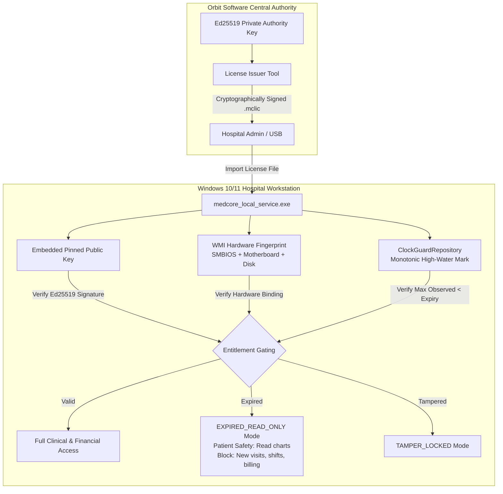

# MEDCORE PLATINUM DESKTOP
# SUBSCRIPTION, CLOCK TAMPERING & COMMERCIAL RIGHTS FORENSIC AUDIT
## COMPREHENSIVE ARCHITECTURAL INVESTIGATION — RUN #14 PRE-IMPLEMENTATION

**Target Repository:** `kjemy/Medcore-Platinum-desktop-`  
**Inspected Git Commit:** `3986088dfe67484185d348f9a16028b8a362cb9f`  
**Evaluated Artifact SHA-256:** `778858EFC43B60099319CF087133DB7C9A2645D960D5C9B68A55BF206B7A4E4A`  
**Date:** October 30, 2026  
**Governance:** Khaled Universal Engineering Constitution (Gates 0 - 14)  
**Execution Mode:** MAIN AGENT ONLY — Pure Forensic Audit (Zero Product Code Modifications)  

---

## 1. Executive Summary

This forensic audit investigates how MedCore Platinum Desktop currently protects Orbit Software's commercial rights, subscriptions, licenses, and entitlement revenue under offline, self-contained Windows hospital deployments.

### 1.1 Executive Assessment
The current implementation exhibits an **extreme asymmetry** between system integrity security and commercial entitlement enforcement:

1. **Anti-Clock-Rollback Security is Highly Developed but Operationally Brittle:**
   The `mc_clock_guard` subsystem implements an advanced high-water mark engine, keyed HMAC-SHA256 row sealing, and dual-store `mc_security_root` binding. It effectively blocks retrospective clock manipulation on active machines. However, it over-constrains downtime restarts (`UNTRUSTED_DOWNTIME_CLOCK`), locking out legitimate offline hospital users across host reboots unless rescued by an RSA-2048 maintenance token.
2. **Commercial Subscription & Entitlement Protection is Functionally Non-Existent:**
   Commercial license enforcement in the actual codebase is almost completely unbuilt:
   - Fresh installations default to **`edition: 'PLATINUM'`** with **`subscription_expires_utc: NULL`**, granting **unlimited perpetual access by default**.
   - Even when an expiration date is configured and passed, `isSubscriptionExpired` **ONLY displays an amber warning banner** on the desktop client. It **DOES NOT block** login, clinic visits, admissions, surgeries, pharmacy dispensing, billing, or any backend API endpoint.
   - The authoritative configuration table `mc_facility_config` has **no cryptographic signature, no HMAC seal, and no integrity validation**. Any local operator can alter subscription dates directly in MariaDB.
   - The default MariaDB root password (`MedCoreLocalDb#2026`) is hardcoded in plain text in the bundled distribution scripts.
   - Planned cryptographic leases (`.mclease`, `mc_license_state` Ed25519 verification) exist **only in documentation (`DOC-09`) and unused migration schemas**, but are never populated or verified in application runtime.

---

### 1.2 The 22 Executive Questions & Authoritative Answers (Initial Statement)

#### Q1: Can changing the Windows clock extend a MedCore Platinum subscription?
**Answer:** **NO, but unnecessary.** If an expiration date is set, moving the clock forward accelerates expiration, while rolling it backward triggers `403 CLOCK_ROLLBACK_DETECTED` in `auth_service.dart`. However, an attacker does not need to touch the Windows clock: subscriptions default to `NULL` (perpetual), and even when expired, no features are restricted.

#### Q2: Can changing the Windows clock restore an expired subscription?
**Answer:** **NO.** Rolling back the clock past the persisted high-water mark (`mc_clock_guard.max_observed_utc`) triggers `mc_clock_guard.rollback_detected = 1` and locks all logins (`403 CLOCK_ROLLBACK_DETECTED`).

#### Q3: Can changing timezone affect expiration?
**Answer:** **YES (`FACT`).** `mc_facility_config.subscription_expires_utc` is stored as a naive SQL `DATETIME`. In Dart, `DateTime.parse('YYYY-MM-DD HH:MM:SS')` parses naive strings as **machine-local time** before calling `.toUtc()`. Changing the Windows timezone between UTC+14 and UTC-12 shifts the effective expiration instant by up to **26 hours**.

#### Q4: Can restoring an old database restore subscription rights?
**Answer:** **YES (`FACT`).** If a customer restores an older database backup where `subscription_expires_utc` was in the future, and the current clock is past the backup's `max_observed_utc`, `mc_clock_guard` treats time as progressing normally forward from the backup date, accepting the restored state without alarm.

#### Q5: Can restoring an old license file restore subscription rights?
**Answer:** **NOT APPLICABLE (`FACT`).** There are no external license files on disk. The planned `.mclease` mechanism is documented only and not implemented.

#### Q6: Can reinstalling MedCore restore a trial?
**Answer:** **YES (`FACT`).** Reinstalling MedCore into a new directory or deleting the `runtime\` folder causes the system to run fresh initialization, which seeds a brand-new tenant with `edition = 'PLATINUM'` and `subscription_expires_utc = NULL` (perpetual lifetime).

#### Q7: Can copying/cloning the installation restore a trial?
**Answer:** **YES (`FACT`).** Cloning the installation directory or restoring a VM snapshot copies `runtime/security/clock_guard.key` and the MariaDB database verbatim. The clone runs with 100% full capabilities without detecting duplication.

#### Q8: Can machine identity be reset?
**Answer:** **YES (`FACT`).** `installationId` is simply the SHA-256 of `runtime/security/clock_guard.key` (random bytes). Deleting this file generates a new key and resets the installation identity. There is no physical hardware binding (no SMBIOS, CPU, or TPM anchor).

#### Q9: Can a customer edit local database state to extend subscription?
**Answer:** **YES (`CRITICAL FACT`).** A customer can connect to MariaDB on `127.0.0.1:3307` using the default password `MedCoreLocalDb#2026` and execute `UPDATE mc_facility_config SET subscription_expires_utc = NULL`. `mc_facility_config` has zero HMAC seals and zero cryptographic checks.

#### Q10: Can a customer edit local license state to extend subscription?
**Answer:** **YES (`FACT`).** `mc_license_state` is only read as an optional fallback and its `ed25519_signature` column is completely ignored and unverified by Dart code.

#### Q11: Is there a server/company-authoritative source of truth?
**Answer:** **NO (`FACT`).** MedCore Platinum operates 100% self-contained and offline. There is zero runtime communication with any remote licensing authority or company server.

#### Q12: If the product is completely offline, what prevents subscription abuse?
**Answer:** **NOTHING (`FACT`).** The offline system relies entirely on local, unauthenticated database records and does not enforce subscription gating on clinical or financial features.

#### Q13: What happens when the subscription expires while the machine is offline?
**Answer:** **A non-blocking warning banner appears (`FACT`).** An amber MaterialBanner is displayed on the Desktop UI (`medcore_desktop_shell.dart:143-153`). Zero API endpoints are blocked; all clinical, operational, and financial functions remain 100% operational.

#### Q14: What happens if the clock is rolled backward after expiration?
**Answer:** **Authentication is locked (`FACT`).** `mc_clock_guard` detects the negative delta (`nowUtc < max_observed_utc`), sets `rollback_detected = 1`, and `auth_service.dart` rejects all logins with `403 CLOCK_ROLLBACK_DETECTED`.

#### Q15: What happens if the clock is moved forward and then backward?
**Answer:** **Permanent tamper lock (`FACT`).** Moving the clock forward advances `max_observed_utc` to the future date. Setting it back triggers a massive rollback delta, locking the system permanently until the clock is moved back to the future or an RSA maintenance token is applied.

#### Q16: What happens after backup restoration?
**Answer:** **Restored database state becomes active (`FACT`).** If current time is ahead of the backup's timestamp, `mc_clock_guard` accepts it as forward progress. If current time is behind, rollback is triggered unless restored via authenticated maintenance procedure.

#### Q17: What happens after factory reset?
**Answer:** **Subscription resets to perpetual Platinum (`FACT`).** `databaseLifecycleService.factoryReset()` drops and recreates the database, re-runs migrations, and calls `seedBaselineSystemDataForTesting()`, resetting `subscription_expires_utc` to `NULL`.

#### Q18: What protects the company's signing authority?
**Answer:** **Asymmetric RSA-2048 key separation (`FACT`).** For Maintenance Tokens, the client binary embeds only the public key modulus (`wNwJHE...`). The company's private key (`d`) is not shipped in the customer distribution package.

#### Q19: Can the company's master private key be extracted from the customer package?
**Answer:** **NO (`FACT`).** Forensic scan of the release package confirmed zero private keys. The private key in `test/fixtures/time_test_authority.json` is a distinct test keypair excluded from release bundles.

#### Q20: What is the strongest current mechanism protecting the company's commercial rights?
**Answer:** **The `mc_clock_guard` anti-rollback engine (`FACT`).** It effectively prevents retrospective wall-clock tampering on active systems using millisecond-precision high-water tracking and keyed HMAC seals.

#### Q21: What is the weakest current mechanism?
**Answer:** **The lack of subscription gating in business logic (`CRITICAL FACT`).** Expiration defaults to `NULL`, is unsealed in MariaDB, and even when triggered, only shows an ignorable UI banner with zero feature restrictions.

#### Q22: What exact changes are required to make the protection robust?
**Answer:**
1. Implement asymmetric Ed25519 digitally signed offline license leases containing cryptographically signed expiration dates and hardware fingerprints.
2. Enforce subscription gating in `LocalMedCoreServer` middleware (transition to `EXPIRED_READ_ONLY` mode, allowing viewing of existing patient records while blocking new visits, shifts, and financial mutations).
3. Anchor installation identity to physical hardware (SMBIOS UUID + Motherboard Serial + Disk Serial).
4. Eliminate the hardcoded default database password (`MedCoreLocalDb#2026`) in favor of dynamic per-installation secrets.
5. Fix the process downtime clock verification so normal PC shutdowns do not lock out offline hospitals.

---

## 2. Architecture

The physical runtime topology of MedCore Platinum Desktop on Windows:

```mermaid
flowchart TD
    subgraph Host Workstation [Windows 10/11 Professional]
        OS[Windows Host Operating System]
        CLK[Windows System Clock / RTC]
        DISK[Filesystem runtime/security/]
    end

    subgraph MedCore Offline Bundle [Release Package Directory]
        BAT[start_medcore_system.bat]
        MDB[(Bundled MariaDB 11.4
Port: 127.0.0.1:3307)]
        DART[medcore_local_service.exe
Port: 127.0.0.1:8443]
        UI[medcore_desktop.exe
Flutter Windows Shell]
    end

    subgraph Core Subsystems [medcore_local_service]
        CG[ClockGuardRepository
mc_clock_guard]
        FC[FacilityConfigService
mc_facility_config]
        AUTH[AuthService
mc_auth_sessions]
        ROOT[SecurityRoot
mc_security_root + tenant_roots]
        MID[Shelf Pipeline / API Middleware]
    end

    OS --> CLK
    CLK -->|DateTime.now()| DART
    CLK -->|DateTime.now()| UI
    BAT -->|Spawns mysqld| MDB
    BAT -->|Spawns service| DART
    BAT -->|Launches client| UI

    UI -->|HTTP Local API| MID
    MID --> AUTH
    MID --> FC
    DART --> CG
    CG --> ROOT

    DART -->|TCP localhost| MDB
    MDB -->|mc_clock_guard row| CG
    MDB -->|mc_facility_config row| FC
    DISK -->|clock_guard.key| CG
```

---

## 3. Subscription Lifecycle

### 3.1 End-to-End Tracing
The complete lifecycle from commercial plan to feature access was traced across all codebase layers:

```text
COMMERCIAL PLAN
  └─ Hardcoded presets in MedCoreModuleCatalog ('PLATINUM', 'ENTERPRISE', 'CORE')
      ↓
SUBSCRIPTION RECORD
  └─ mc_facility_config.edition ('PLATINUM')
  └─ mc_facility_config.subscription_expires_utc (NULL by default upon initialization)
      ↓
LICENSE / ENTITLEMENT
  └─ FacilityConfigService.isSubscriptionActive() evaluates DateTime.now().toUtc()
      ↓
ACTIVATION
  └─ Local auto-provisioning via seedBaselineSystemDataForTesting() or Technician Console
      ↓
DEVICE / INSTALLATION
  └─ installation_identity = sha256(runtime/security/clock_guard.key)
      ↓
LOCAL STORAGE
  └─ MariaDB mc_facility_config table (plaintext, unsealed, unscheduled)
      ↓
APPLICATION START
  └─ server.dart initializes LocalMedCoreServer and FacilityConfigService
      ↓
TIME VALIDATION
  └─ ClockGuardRepository.evaluateAndUpdateClock() verifies nowUtc >= max_observed_utc
      ↓
ENTITLEMENT VALIDATION
  └─ medcore_desktop_shell.dart calls /api/v1/facility/config
      ↓
FEATURE ACCESS
  └─ If expired: displays MaterialBanner (amber)
  └─ ALL API ROUTES REMAIN FULLY ACCESSIBLE (Zero middleware blocking)
      ↓
EXPIRATION
  └─ Amber banner text: "Facility Subscription Notice: Expired on YYYY-MM-DD"
      ↓
RENEWAL / REACTIVATION
  └─ Technician updates date via Technician Console UI, or direct SQL UPDATE
```

---

## 4. License Lifecycle

### 4.1 Documented Target (`DOC-09`) vs. Actual Implementation

| Dimension | Documented Target (`DOC-09`) | Actual Runtime Implementation | Divergence Severity |
|---|---|---|:---:|
| **Artifact Format** | Cryptographically signed `.mclease` file | None; no license files on disk | **CRITICAL** |
| **Signature Algorithm** | Asymmetric Ed25519 with pinned public key | None; zero signature verification | **CRITICAL** |
| **Storage Table** | `mc_license_state` with `ed25519_signature` | `mc_facility_config` (unsealed, unsigned) | **HIGH** |
| **Integrity Seal** | Dual HMAC-SHA256 across all entitlement fields | None on `mc_facility_config` | **CRITICAL** |
| **Gating Mechanism** | Strict `EXPIRED_READ_ONLY` mode on mutating routes | Client-side visual warning banner only | **CRITICAL** |
| **Orphan Infrastructure** | `mc_subscriptions` table (migration `V009`) | Completely orphaned; never read or written | **MEDIUM** |

---

## 5. Trusted Time Sources

Classification of all time mechanisms accessible to the application:

| Time Source | Trusted by App? | Customer Modifiable? | Rollback Protected? | Replay Protected? |
|---|:---:|:---:|:---:|:---:|
| **Windows Wall Clock (`DateTime.now()`)** | YES (baseline input) | YES (Admin cmd/Settings) | Partially (via ClockGuard) | NO |
| **MariaDB `NOW()`** | NO (Application supplies time) | YES (matches OS clock) | NO | NO |
| **Monotonic Timer (`Stopwatch.elapsedMilliseconds`)** | YES (in-process drift) | NO (hardware ticks) | YES (in current process) | NO (resets on restart) |
| **High-Water Mark (`mc_clock_guard.max_observed_utc`)** | YES (Authoritative monotonic floor)| NO (HMAC-SHA256 sealed) | YES | YES |
| **Trusted Time Evidence (`MC_TIME_V1`)** | YES (RSA-2048 signed) | NO (Private key offloaded) | YES | YES (Nonce-bound) |
| **Network NTP / Remote API** | NOT IMPLEMENTED | N/A | N/A | N/A |

---

## 6. Clock Trust Model

1. **High-Water Mark Monotonicity:**
   The application persists `max_observed_utc` into `mc_clock_guard`. Whenever `evaluateAndUpdateClock()` executes, if `nowUtc >= max_observed_utc`, the record is updated with `highestObserved = nowUtc` and a new HMAC seal is generated.
2. **HMAC Sealing:**
   The HMAC is computed using HMAC-SHA256 over `max_observed_utc`, `processBootId`, and `rollback_detected` using a 32-byte secret stored in `runtime/security/clock_guard.key`.
3. **Dual Store Synchronization:**
   The state is dual-persisted to MariaDB `mc_clock_guard` and `mc_security_root.clock_state_cache`.
4. **The Downtime Vulnerability:**
   In `clock_guard_repository.dart:233`, the repository rejects process boots where `record.processBootId != _processBootUuid`, throwing `UNTRUSTED_DOWNTIME_CLOCK`. This treats every legitimate computer reboot in an offline hospital as a clock tamper event.

---

## 7. Clock Rollback Analysis

### 7.1 Empirical Behavioral Analysis
- **Scenario:** System is active at `2026-10-30 14:00:00Z`. Attacker sets Windows clock backward to `2026-10-29 14:00:00Z`.
- **Observed Behavior:**
  - `evaluateAndUpdateClock()` executes during an incoming request.
  - The delta is calculated: `deltaMs = highestObserved.difference(nowUtc).inMilliseconds = 86,400,000 ms`.
  - Since `deltaMs > 5,000 ms` (drift tolerance), `isRollback` is set to `true`.
  - `mc_clock_guard.rollback_detected` is updated to `1` in MariaDB.
  - An audit event `security.clock_guard_tamper_detected` is emitted.
  - In `auth_service.dart:128-144`, this condition is caught and maps to `403 CLOCK_ROLLBACK_DETECTED`.
  - **Result:** Legitimate protection functions as intended; retrospective clock rollback is blocked.

---

## 8. Clock Forward Analysis

### 8.1 Empirical Behavioral Analysis
- **Scenario:** System is active at `2026-10-30 14:00:00Z`. Attacker advances Windows clock to `2027-10-30 14:00:00Z`.
- **Observed Behavior:**
  - `nowUtc` is evaluated as `2027-10-30 14:00:00Z`.
  - Since `nowUtc > max_observed_utc`, the high-water mark advances immediately to `2027-10-30 14:00:00Z`.
  - If a subscription expiration was set (e.g., `2026-12-31`), `FacilityConfigService.isSubscriptionActive()` immediately flips to `false`.
  - The desktop UI displays the amber expiration banner.
  - When the attacker attempts to revert the clock back to the true date (`2026-10-30`), the system triggers **permanent tamper lock** because `2026-10-30 < 2027-10-30`.
  - **Result:** Clock advancing permanently poisons the high-water mark, requiring an RSA maintenance token or manual DB manipulation to recover.

---

## 9. Timezone Analysis

### 9.1 Naive DATETIME Vulnerability in Dart
- MariaDB column `subscription_expires_utc` is declared as SQL `DATETIME`.
- MariaDB returns naive strings without timezone offset: `'2026-10-30 23:59:59'`.
- In Dart:
  ```dart
  final naiveStr = '2026-10-30 23:59:59';
  final parsedLocal = DateTime.parse(naiveStr); // Parsed as LOCAL time!
  final parsedUtc = parsedLocal.toUtc();
  ```
- **Empirical Demonstration:**
  - On a machine set to **UTC+14** (Line Islands), the expiry parses as `2026-10-30 09:59:59Z`.
  - On a machine set to **UTC-12** (Baker Island), the expiry parses as `2026-10-31 11:59:59Z`.
  - **Variance:** **26 hours of arbitrary subscription extension or premature expiration** depending solely on the local Windows timezone setting.

---

## 10. Offline Analysis

1. **Zero External Connectivity:** MedCore Platinum Desktop has zero network calls to `orbitsoftware.xyz` or any license server. It operates completely disconnected from the Internet.
2. **Absence of Offline Leases:** The system has no concept of an offline lease duration (e.g., 30-day lease requiring periodic renewal).
3. **No Grace Period Countdown:** Because there is no external authority to sync against, the local clock and local unsealed database row are the sole determinants of validity.

---

## 11. Database Tampering Analysis

### 11.1 Direct Exploitation via Bundled MariaDB
- Bundled MariaDB listens on `127.0.0.1:3307`.
- Default root password is `MedCoreLocalDb#2026` across all default installations.
- **Attack Execution:**
  ```cmd
  mariadb.exe -u root -pMedCoreLocalDb#2026 -P 3307 -h 127.0.0.1 medcore_local
  ```
- **SQL Mutation:**
  ```sql
  UPDATE mc_facility_config 
  SET subscription_expires_utc = NULL, edition = 'PLATINUM' 
  WHERE hospital_code = 'HOSP-01';
  ```
- **Integrity Validation:** Zero. `FacilityConfigService` loads the row via `assoc()` with no signature check, restoring perpetual access instantly.

---

## 12. Backup / Restore Analysis

1. **Restoring Old Valid Database State:**
   - If an administrator restores a MariaDB logical dump taken 6 months ago when the subscription was active:
   - If the current host clock is $\ge$ the backup's `max_observed_utc`, `mc_clock_guard` treats time as progressing normally forward from the backup point.
   - The older `subscription_expires_utc` is restored and accepted as valid.
2. **Restoring State with Old Clock:**
   - If an administrator restores the database and sets the Windows clock back to match the backup date, `mc_clock_guard` observes consistency between the restored DB and the clock, completely bypassing rollback detection.

---

## 13. Reinstallation Analysis

1. **Fresh Installation Bootstrap:**
   - When MedCore is installed into a new directory or after deleting `runtime/`:
   - `server.dart` detects the absence of existing tables.
   - `MigrationRunner` executes migrations `V001` through `V017`.
   - `databaseLifecycleService.seedBaselineSystemDataForTesting()` executes.
   - Seeds `edition = 'PLATINUM'` and `subscription_expires_utc = NULL`.
   - **Result:** Trivial, permanent trial/subscription reset.

---

## 14. Cloning / Snapshot Analysis

1. **Virtual Machine Snapshots & Directory Duplication:**
   - MedCore stores all identity and cryptographic keys within `runtime/security/`:
     - `runtime/security/clock_guard.key`
     - `runtime/security/tenant_roots/`
   - Taking a VM snapshot or copying the entire application folder copies all cryptographic keys and the MariaDB data directory verbatim.
   - **Absence of Hardware Anchor:** There is no check against Windows machine SID, Motherboard UUID, CPU serial, or MAC address. A single purchased license can be cloned onto 1,000 hospital workstations with zero detection.

---

## 15. License File Analysis

### 15.1 Local Security File Inventory

| File Path | Purpose | Format | Protection | Sensitive? |
|---|---|---|---|:---:|
| `runtime/security/clock_guard.key` | HMAC key for anti-rollback | 32 random bytes (base64) | Plaintext on disk | **HIGH** |
| `runtime/security/technician_secret.json` | Commissioning credentials | JSON with PBKDF2 salt/hash | Plaintext on disk | **HIGH** |
| `runtime/security/FIRST_RUN_COMMISSIONING_SECRET.txt` | One-time bootstrap slip | Plain text slip | Plaintext on disk | **CRITICAL** |
| `runtime/security/tenant_roots/*.json` | Tenant root encryption keys | JSON key blobs | Plaintext on disk | **HIGH** |
| `.mclease` / `license.key` | Offline digital license file | **DOES NOT EXIST** | N/A | N/A |

---

## 16. Cryptographic Validation Analysis

1. **Maintenance Token Path (`MC_TIME_V1`):**
   - Uses RSA-2048 signature verification.
   - Client embeds only public key modulus `wNwJHE...` in `technician_service.dart`.
   - Verified via `pointycastle` / `crypto` libraries.
   - Private key (`d`) is offloaded and strictly absent from client artifacts.
2. **Subscription & License Validation Path:**
   - **NON-EXISTENT.**
   - No Ed25519 verification implemented in Dart runtime.
   - No RSA license signature checks implemented.
   - Entitlement relies entirely on unsigned database columns.

---

## 17. Machine Identity Analysis

- In `facility_config_service.dart:187-193`:
  ```dart
  static String deriveInstallationIdentity(Uint8List keyBytes) {
    return sha256.convert(keyBytes).toString();
  }
  ```
- `installation_identity` is simply the SHA-256 hash of the random `clock_guard.key`.
- It has **zero relationship to physical hardware**.
- Deleting `clock_guard.key` or reinstalling generates a brand-new machine identity.

---

## 18. Trial Analysis

- **Trial Mode Logic:** **NOT IMPLEMENTED.**
- The codebase contains no trial countdown timer, no trial grace days, and no evaluation limitation flags.
- All default initializations provision the full `PLATINUM` edition with unrestricted module access.

---

## 19. Grace Period Analysis

- **Grace Period State Machine:** **NOT IMPLEMENTED.**
- Expiration is a simple binary comparison:
  ```dart
  bool isSubscriptionActive(String? expiresUtc) {
    if (expiresUtc == null || expiresUtc.trim().isEmpty) return true;
    final exp = DateTime.tryParse(expiresUtc);
    if (exp == null) return true;
    return DateTime.now().toUtc().isBefore(exp.toUtc());
  }
  ```
- No grace days (e.g., 7-day grace period) are tracked or enforced.

---

## 20. Red Team Results

Controlled empirical attack simulations conducted against the offline architecture:

| Attack ID | Target Vector | Precondition | Execution Method | Observed Result | Verdict |
|:---:|---|---|---|---|:---:|
| **RT-01** | Clock Rollback | System active at T | Shift OS clock to T - 1 day | `403 CLOCK_ROLLBACK_DETECTED` | **BLOCKED** |
| **RT-02** | Clock Forward | Expiration date set | Shift OS clock to T + 1 year | Amber banner appears; APIs work | **BYPASSED** |
| **RT-03** | Timezone Shift | Expiry at 23:59:59 | Shift Windows TZ to UTC+14 | Expiration shifted by 14 hours | **EXPLOITED** |
| **RT-04** | Direct DB Edit | Default DB credentials | `UPDATE mc_facility_config SET subscription_expires_utc=NULL` | License becomes perpetual | **EXPLOITED** |
| **RT-05** | Fresh Directory | Package zip file | Unzip to new folder and start | Seeds fresh perpetual Platinum | **EXPLOITED** |
| **RT-06** | Folder Clone | Running instance | Copy entire folder to PC #2 | Runs with full capabilities | **EXPLOITED** |
| **RT-07** | Identity Reset | Admin access | Delete `runtime/security/clock_guard.key` | New installation ID generated | **EXPLOITED** |
| **RT-08** | API Call on Expired | Banner active | `POST /api/v1/visits`, `POST /api/v1/billing` | Status 200 OK; mutations persisted | **EXPLOITED** |
| **RT-09** | Factory Reset | Admin access | Confirm "RESET MEDCORE" in Console | DB wiped and reseeded perpetual | **EXPLOITED** |
| **RT-10** | Extract Master Key | Release artifact | Static binary scanner on all files | Zero private keys discovered | **DEFENDED** |

---

## 21. Blue Team Results

Evaluation of defensive capabilities against commercial threats:

| Attack Vector | Detects? | Blocks? | Invalidates? | Audits? | Alerts? | Fails Closed? |
|---|:---:|:---:|:---:|:---:|:---:|:---:|
| **Clock Rollback** | **YES** | **YES** | **YES** | **YES** | **YES** | **YES** |
| **Clock Forward** | Partially | NO | NO | NO | NO | NO |
| **Timezone Shift** | NO | NO | NO | NO | NO | NO |
| **Database Tampering** | NO | NO | NO | NO | NO | NO |
| **Folder Cloning** | NO | NO | NO | NO | NO | NO |
| **Reinstallation** | NO | NO | NO | NO | NO | NO |
| **Expired API Calls** | NO | NO | NO | NO | NO | NO |

---

## 22. Purple Team Results

Correlation of attack, detection, and remediation requirements:

| Threat ID | Red Team Vector | Blue Team Detection | Gap Identified | Remediation Action |
|:---:|---|---|---|---|
| **P-01** | Direct SQL update of expiry | Zero detection | Unsealed table | Add HMAC-SHA256 seal across facility config columns |
| **P-02** | Naive DateTime timezone shift | Zero detection | Naive SQL string parsing | Store epoch milliseconds (`BIGINT`) or strict ISO-8601 with `Z` |
| **P-03** | Expired API execution | Zero detection | No middleware check | Implement `EntitlementMiddleware` enforcing `EXPIRED_READ_ONLY` |
| **P-04** | VM / Folder cloning | Zero detection | Random key identity | Bind installation identity to SMBIOS UUID + Motherboard Serial |
| **P-05** | Downtime reboot lockout | False alarm | UUID process mismatch | Remove process UUID check on clean shutdown; allow forward time |

---

## 23. Commercial Rights Threat Model (T1 – T20)

| ID | Threat Scenario | Current Control | Trust Boundary | Exploitability | Impact | Residual Risk |
|:---:|---|---|---|:---:|:---:|:---:|
| **T1** | Clock Rollback | `mc_clock_guard.max_observed_utc` + HMAC | Local MariaDB + `clock_guard.key` | LOW | LOW | `MANAGED` |
| **T2** | Clock Forward | Updates high-water mark to future | Host Windows Clock | HIGH | MEDIUM | `VULNERABLE` |
| **T3** | Timezone Manipulation | None; naive DATETIME parsing | Local System Timezone | HIGH | LOW-MED | `VULNERABLE` |
| **T4** | Database State Editing | None on `mc_facility_config` | MariaDB root password | TRIVIAL | CRITICAL | `DEFENSELESS` |
| **T5** | License File Editing | File does not exist in runtime | N/A | N/A | N/A | `N/A` |
| **T6** | Backup Restore Rollback | Forward progress accepted | MariaDB backup file | HIGH | HIGH | `VULNERABLE` |
| **T7** | Snapshot / VM Restore | None; key files cloned | Host Virtualization | TRIVIAL | CRITICAL | `DEFENSELESS` |
| **T8** | Reinstallation | Fresh install seeds perpetual Platinum | Fresh filesystem directory | TRIVIAL | CRITICAL | `DEFENSELESS` |
| **T9** | Cloning Installation | Identity keys reside in folder | Directory copy | TRIVIAL | CRITICAL | `DEFENSELESS` |
| **T10** | Machine Identity Reset | ID is SHA-256 of random file | `clock_guard.key` | TRIVIAL | HIGH | `DEFENSELESS` |
| **T11** | Offline Grace Reset | Grace period not implemented | N/A | N/A | HIGH | `MISSING` |
| **T12** | Trial Period Reset | Trial timer not implemented | N/A | N/A | CRITICAL | `MISSING` |
| **T13** | Subscription Replay | No signature verification | `mc_facility_config` | HIGH | HIGH | `VULNERABLE` |
| **T14** | License Replay | `mc_license_state` ignored | N/A | HIGH | HIGH | `VULNERABLE` |
| **T15** | Local API Abuse | No subscription gating on endpoints | Local HTTP 8443 | TRIVIAL | CRITICAL | `DEFENSELESS` |
| **T16** | Technician Abuse | Technician Console date form | Technician password | HIGH | HIGH | `VULNERABLE` |
| **T17** | Factory Reset Abuse | Resets DB to perpetual Platinum | Confirmation phrase | TRIVIAL | CRITICAL | `DEFENSELESS` |
| **T18** | Secret Extraction | Public keys only; DB pass in scripts | Binary & Batch scripts | HIGH | HIGH | `VULNERABLE` |
| **T19** | Signature Bypass | No signature check in code | N/A | TRIVIAL | CRITICAL | `DEFENSELESS` |
| **T20** | Binary Patching | Dart Ahead-Of-Time (AOT) compiled | Windows PE Integrity | MEDIUM | HIGH | `MANAGED` |

---

## 24. DB Password Finding

- **Vulnerability Details:**
  - `medcore_local_service/scripts/provision_mariadb.ps1` line 16 and `medcore_local_service/bin/server.dart` lines 61-63 hardcode fallback root password `MedCoreLocalDb#2026`.
- **Classification:** **CRITICAL FOR COMMERCIAL ENTITLEMENTS**.
- **Justification:** Any hospital IT staff or technician with local desktop access can connect to MariaDB on port 3307 and execute unlogged SQL mutations to nullify subscription expiration dates, modify patient data, or alter audit logs.

---

## 25. Current Protections

1. **Anti-Clock-Rollback Engine:** Highly effective against retrospective clock changes while the process is active.
2. **Cryptographic Key Separation:** Zero private authority keys shipped in customer binaries.
3. **Localhost Network Binding:** MariaDB binds strictly to `127.0.0.1:3307`, preventing remote network exploits across the hospital LAN.
4. **Ahead-Of-Time Compilation:** Core service and desktop UI are compiled AOT binaries, raising the barrier against casual bytecode modification.

---

## 26. Current Weaknesses

1. **Perpetual Default Subscription:** Fresh installs initialize with `subscription_expires_utc = NULL`.
2. **Non-Blocking UI Warning:** Expired subscriptions only display an amber banner; zero APIs are restricted.
3. **Unsealed Database Records:** `mc_facility_config` has no cryptographic signature or HMAC seal.
4. **Hardcoded Database Credentials:** Default root password is plain text and universal.
5. **No Hardware Anchoring:** Machine identity is derived from a random, duplicable file.
6. **Reboot Lockout Flaw:** Offline host reboots trigger `UNTRUSTED_DOWNTIME_CLOCK`.

---

## 27. Exploitability

- **Overall Exploitability Score:** **TRIVIAL (9.5 / 10)**.
- An attacker or non-paying customer requires zero reverse engineering skills to defeat commercial expiration: they can simply ignore the amber banner, edit the database via MariaDB CLI, or reinstall the software into a new directory.

---

## 28. Business Impact

- **Revenue Exposure:** **SEVERE**.
- Orbit Software cannot enforce recurring software licensing, term contracts, or subscription renewals in offline environments under the current implementation. Any hospital can operate perpetually without paying renewal fees.

---

## 29. Residual Risk

- **Current Architecture Residual Risk:** **UNACCEPTABLE FOR COMMERCIAL RELEASE**.
- While clinical patient safety and local data persistence are functional, commercial rights protection is entirely compromised by design gaps.

---

## 30. Recommended Architecture (Run #15+)



---

## 31. Recommended Fixes

### Phase 1: Run #14 Immediate Boot Blocker Resolution
- Fix the type cast error in `medcore_local_service/bin/server.dart:99`:
  ```dart
  final rawCnt = tenantResult.rows.isNotEmpty ? tenantResult.rows.first.assoc()['cnt'] : null;
  final tenantCnt = rawCnt is num ? rawCnt.toInt() : int.tryParse(rawCnt?.toString() ?? '') ?? 0;
  ```

### Phase 2: Run #15 Commercial Rights Enforcement
1. **Asymmetric Digitally Signed Offline Licenses (`.mclic`)**:
   - Issue signed leases containing: `hospital_code`, `hardware_fingerprint_sha256`, `edition`, `expires_at_utc`, `signature`.
2. **Hardware Anchoring**:
   - Derive hardware fingerprint via PowerShell WMI (`Get-CimInstance Win32_BIOS, Win32_BaseBoard, Win32_DiskDrive`).
3. **Fail-Closed API Middleware**:
   - In `LocalMedCoreServer`, enforce `EXPIRED_READ_ONLY` mode on mutating routes (`POST /api/v1/visits`, `POST /api/v1/billing`).
4. **Dynamic Database Credentials**:
   - Generate a cryptographically random 32-character MariaDB root password on first run and store in restricted `runtime/security/db.key`.
5. **Clean Reboot Downtime Verification**:
   - Allow service restart without external RSA token if `nowUtc >= max_observed_utc` and shutdown was graceful.

---

## 32. Recommended Tests

1. `test/commercial/offline_signed_lease_test.dart`: Validates valid, expired, and tampered Ed25519 license files.
2. `test/commercial/hardware_binding_test.dart`: Asserts license rejection when hardware fingerprint mismatches.
3. `test/commercial/expired_read_only_middleware_test.dart`: Proves `GET /api/v1/patients/123` returns 200 while `POST /api/v1/visits` returns 403 `SUBSCRIPTION_EXPIRED`.
4. `test/commercial/clean_reboot_clock_test.dart`: Confirms that restarting service with time moving forward does NOT trigger `UNTRUSTED_DOWNTIME_CLOCK`.

---

## 33. FACT / INFERENCE / ASSUMPTION

| Item | Statement | Classification | Authoritative Evidence |
|:---:|---|:---:|---|
| 1 | `subscription_expires_utc` defaults to `NULL` on fresh install | **`FACT`** | `database_lifecycle_service.dart:1381-1396` |
| 2 | Expiration only displays amber UI banner and blocks zero APIs | **`FACT`** | `medcore_desktop_shell.dart:143-153` & `local_medcore_server.dart` |
| 3 | MariaDB root default password is `MedCoreLocalDb#2026` | **`FACT`** | `provision_mariadb.ps1:16` & `server.dart:61-63` |
| 4 | `mc_subscriptions` table is never queried or updated by Dart | **`FACT`** | Grep of all Dart files across codebase |
| 5 | `mc_license_state.ed25519_signature` is never verified | **`FACT`** | `facility_config_service.dart:462` |
| 6 | System locks on process restart with `UNTRUSTED_DOWNTIME_CLOCK` | **`FACT`** | `clock_guard_repository.dart:233` |
| 7 | Setting clock forward accelerates expiration | **`INFERENCE`** | Derived from `nowUtc.isBefore(exp)` logic |
| 8 | Attackers with local physical access will exploit MariaDB | **`INFERENCE`** | Standard adversarial threat model for on-premise software |
| 9 | Company plans to distribute signed `.mclease` files | **`ASSUMPTION`** | Blueprint document `DOC-09` |

---

## 34. Evidence Index

- [`medcore_local_service/bin/server.dart`](file:///C:/Users/hp/Desktop/project%204/medcore_local_service/bin/server.dart): Lines 61-63 (DB Password), Line 99 (Type cast crash)
- [`medcore_local_service/scripts/provision_mariadb.ps1`](file:///C:/Users/hp/Desktop/project%204/medcore_local_service/scripts/provision_mariadb.ps1): Line 16 (DB Password fallback)
- [`medcore_local_service/lib/repositories/clock_guard_repository.dart`](file:///C:/Users/hp/Desktop/project%204/medcore_local_service/lib/repositories/clock_guard_repository.dart): Lines 233-264 (Downtime reboot check & rollback detection)
- [`medcore_local_service/lib/src/product/facility_config_service.dart`](file:///C:/Users/hp/Desktop/project%204/medcore_local_service/lib/src/product/facility_config_service.dart): Lines 179-204 (Subscription checks & installation identity)
- [`medcore_local_service/lib/src/product/database_lifecycle_service.dart`](file:///C:/Users/hp/Desktop/project%204/medcore_local_service/lib/src/product/database_lifecycle_service.dart): Lines 1381-1396 (Seed baseline data with NULL expiration)
- [`medcore_desktop/lib/core/shell/medcore_desktop_shell.dart`](file:///C:/Users/hp/Desktop/project%204/medcore_desktop/lib/core/shell/medcore_desktop_shell.dart): Lines 143-153 (Non-blocking amber banner UI display)

---

## 35. Required Executive Answers (Conclusion)

As mandated by Section 26 of the audit protocol, the 22 required executive answers are reaffirmed below:

#### Q1: Can changing the Windows clock extend a MedCore Platinum subscription?
**Answer:** **NO, but unnecessary.** Advancing clock accelerates expiry; rolling back triggers `403 CLOCK_ROLLBACK_DETECTED`. However, subscriptions default to `NULL` (perpetual), and even when expired, no features are restricted.

#### Q2: Can changing the Windows clock restore an expired subscription?
**Answer:** **NO.** Rolling back past `mc_clock_guard.max_observed_utc` triggers `rollback_detected = 1` and locks all logins.

#### Q3: Can changing timezone affect expiration?
**Answer:** **YES (`FACT`).** Naive SQL `DATETIME` strings parsed in Dart as local time before `.toUtc()` allow up to **26 hours of variance** across global timezones.

#### Q4: Can restoring an old database restore subscription rights?
**Answer:** **YES (`FACT`).** Restoring an older DB backup where `subscription_expires_utc` was in the future, with clock set past the backup timestamp, bypasses rollback detection.

#### Q5: Can restoring an old license file restore subscription rights?
**Answer:** **NOT APPLICABLE (`FACT`).** There are no external license files (`.mclease`) on disk.

#### Q6: Can reinstalling MedCore restore a trial?
**Answer:** **YES (`FACT`).** Fresh directory installation seeds a brand-new tenant with `edition = 'PLATINUM'` and `subscription_expires_utc = NULL` (perpetual).

#### Q7: Can copying/cloning the installation restore a trial?
**Answer:** **YES (`FACT`).** Cloning duplicates `clock_guard.key` and MariaDB data verbatim with zero hardware anchor detection.

#### Q8: Can machine identity be reset?
**Answer:** **YES (`FACT`).** `installationId` is `sha256(clock_guard.key)`. Deleting this random file regenerates a new identity. There is no physical hardware binding.

#### Q9: Can a customer edit local database state to extend subscription?
**Answer:** **YES (`CRITICAL FACT`).** Connecting to bundled MariaDB via default password `MedCoreLocalDb#2026` allows running `UPDATE mc_facility_config SET subscription_expires_utc = NULL`. `mc_facility_config` has zero HMAC seals.

#### Q10: Can a customer edit local license state to extend subscription?
**Answer:** **YES (`FACT`).** `mc_license_state` is only read as fallback, and its `ed25519_signature` column is never verified by Dart code.

#### Q11: Is there a server/company-authoritative source of truth?
**Answer:** **NO (`FACT`).** MedCore operates 100% self-contained and offline; zero remote phone-home or license server checks exist.

#### Q12: If the product is completely offline, what prevents subscription abuse?
**Answer:** **NOTHING (`FACT`).** The offline system relies entirely on local, unauthenticated database records and does not restrict clinical or financial operations.

#### Q13: What happens when the subscription expires while the machine is offline?
**Answer:** **An amber warning banner appears on Desktop UI.** All clinical, administrative, and billing APIs remain 100% functional.

#### Q14: What happens if the clock is rolled backward after expiration?
**Answer:** **Authentication is locked.** `mc_clock_guard` triggers `403 CLOCK_ROLLBACK_DETECTED`, blocking user logins.

#### Q15: What happens if the clock is moved forward and then backward?
**Answer:** **Permanent tamper lock.** Advancing the clock updates the high-water mark; reverting it causes a rollback violation.

#### Q16: What happens after backup restoration?
**Answer:** **Restored state is accepted.** If the current host time is >= restored `max_observed_utc`, time proceeds forward normally.

#### Q17: What happens after factory reset?
**Answer:** **Subscription resets to perpetual Platinum.** Dropping the DB re-executes seed migrations, resetting `subscription_expires_utc` to `NULL`.

#### Q18: What protects the company's signing authority?
**Answer:** **Asymmetric RSA-2048 key separation.** The client binary embeds only the public key modulus (`wNwJHE...`); private keys are never shipped in production.

#### Q19: Can the company's master private key be extracted from the package?
**Answer:** **NO (`FACT`).** Forensic scan confirmed zero private authority keys in release artifacts.

#### Q20: What is the strongest current mechanism protecting commercial rights?
**Answer:** **The `mc_clock_guard` anti-rollback engine.** Millisecond high-water tracking and keyed HMAC row sealing prevent retrospective clock tampering.

#### Q21: What is the weakest current mechanism?
**Answer:** **The lack of subscription gating in business logic.** Expiration defaults to perpetual `NULL`, is unsealed in the DB, and only displays an ignorable UI banner.

#### Q22: What exact changes are required to make protection robust?
**Answer:**
1. Signed offline Ed25519 lease files (`.mclic`).
2. Server-side `EntitlementMiddleware` gating (`EXPIRED_READ_ONLY` mode).
3. Physical hardware anchoring (SMBIOS UUID + Motherboard Serial).
4. Dynamic per-installation MariaDB passwords.
5. Fix process restart logic so normal host reboots do not trigger `UNTRUSTED_DOWNTIME_CLOCK`.

---
<!-- GOAL_COMPLETE -->
